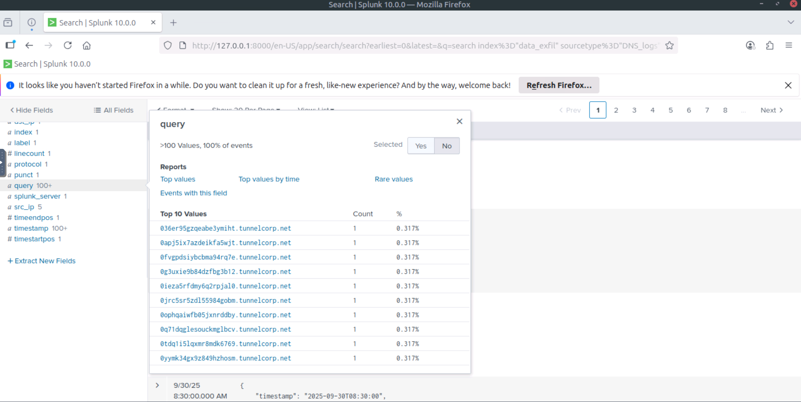
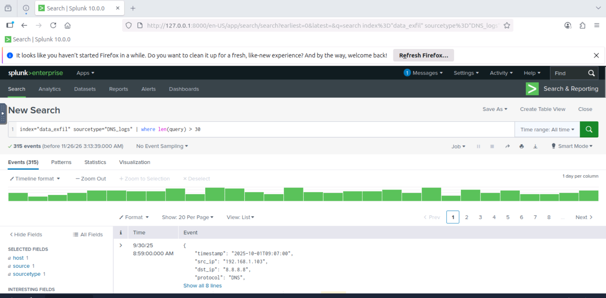
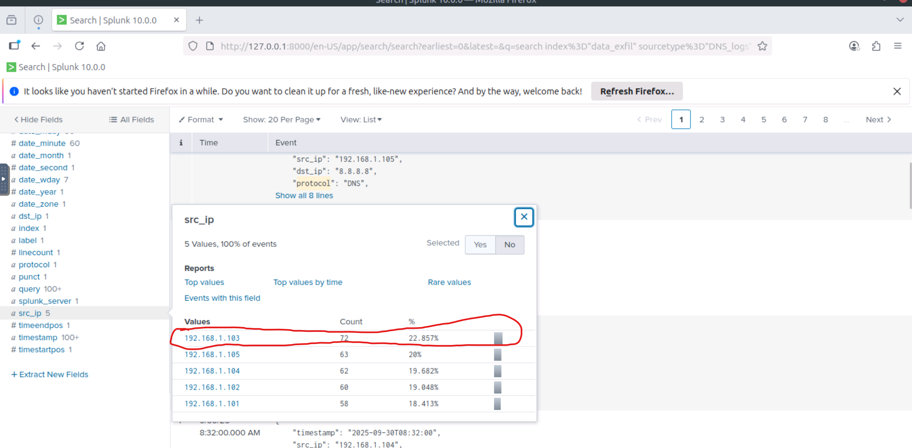
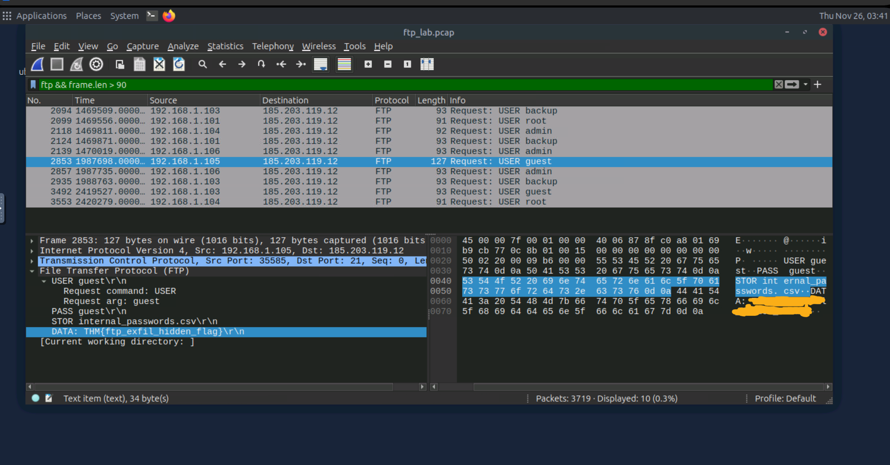
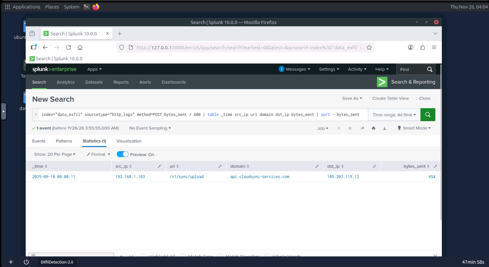
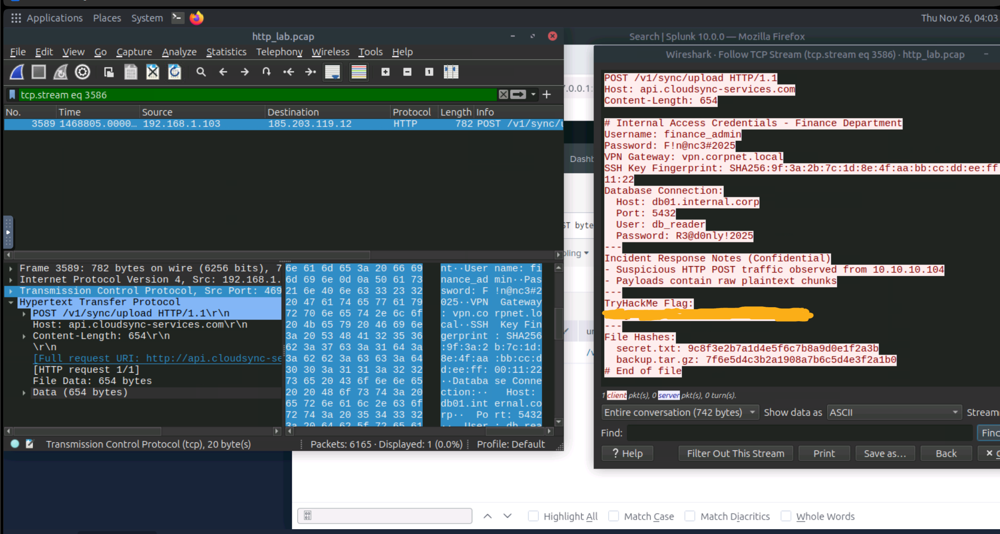
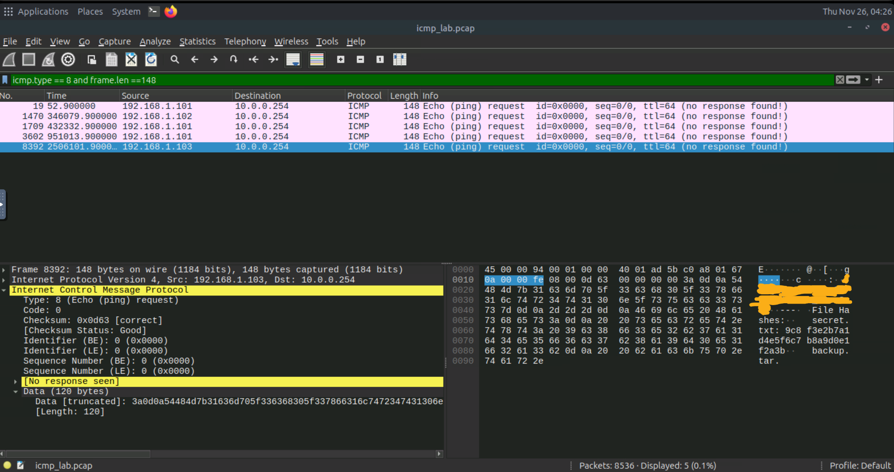

# Data Exfiltration Detection | TryHackMe SOC Level 1

## Investigation overview

- **Analyst:** Erick Hambardzumyan
- **Platform:** TryHackMe — SOC Level 1
- **Environment:** Simulated security investigation
- **Tools:** Splunk Enterprise, Wireshark
- **Status:** Analysis documented
- **Assessment:** High priority within the lab; real-world incident severity not assessed

## Objective

Detect and investigate potential data exfiltration over DNS, FTP, HTTP and ICMP using SIEM searches and packet analysis. Identify affected hosts, suspicious destinations, observable payloads and opportunities for detection and mitigation.

## 1. DNS tunneling detection

I examined DNS events in Splunk using the following SPL search:

```spl
index="data_exfil" sourcetype="DNS_logs"
```

Inspection of the `query` field revealed numerous random-looking alphanumeric subdomains under `tunnelcorp.net`. Each of the ten displayed query values occurred once. Such patterns may indicate encoded data being transmitted through DNS, although the encoding and underlying content were not verified.



I then filtered DNS queries by length:

```spl
index="data_exfil" sourcetype="DNS_logs" | where len(query) > 30
```

The search returned **315 events**. The threshold applies to the entire query string, not just the subdomain, and is a lab-specific heuristic rather than proof of malicious activity.



Analysis of the `src_ip` field revealed five internal hosts:

| Source IP | Matching events | Share |
|---|---:|---:|
| 192.168.1.103 | 72 | 22.86% |
| 192.168.1.105 | 63 | 20.00% |
| 192.168.1.104 | 62 | 19.68% |
| 192.168.1.102 | 60 | 19.05% |
| 192.168.1.101 | 58 | 18.41% |
| **Total** | **315** | **100%** |



The most active source, `192.168.1.103`, was prioritized for further investigation. The observed destination, `8.8.8.8`, is Google Public DNS, not an identified attacker server. The authoritative DNS infrastructure behind the suspicious domain was not established.

**Assessment:** Suspected DNS tunneling. Query length and random-looking labels warrant investigation but do not independently establish compromise or successful data transfer.

## 2. FTP exfiltration detection

I analyzed `ftp_lab.pcap` in Wireshark using the display filter:

```wireshark
ftp && frame.len > 90
```

Ten of 3,719 packets matched. Frame 2853 was particularly notable because it contained a 127-byte packet with FTP commands and a lab payload.

| Field | Observation |
|---|---|
| Frame | 2853 |
| Source IP | 192.168.1.105 |
| Destination IP | 185.203.119.12 |
| Destination TCP port | 21 |
| FTP command | STOR |
| Filename | internal_passwords.csv |
| Payload | Plaintext lab marker |

The packet contained plaintext authentication commands and a `STOR` request for a filename suggesting sensitive credentials. A lab marker was visible in the captured bytes. The capture therefore shows an apparent upload attempt and exposed plaintext content; a successful server-side file write was not independently verified.



**Assessment:** Strong evidence of simulated FTP exfiltration activity. The external destination and internal source warrant investigation.

## 3. HTTP exfiltration detection

### SIEM detection

I examined HTTP POST events in Splunk using the following search:

```spl
index="data_exfil" sourcetype="http_logs" method=POST bytes_sent > 600 | table _time src_ip uri domain dst_ip bytes_sent | sort - bytes_sent
```

The search returned one event:

| Field | Observation |
|---|---|
| Splunk event time (as displayed) | 2025-09-18 00:00:11 |
| Source IP | 192.168.1.103 |
| Destination IP | 185.203.119.12 |
| Domain | api.cloudsync-services.com |
| URI | /v1/sync/upload |
| Method | POST |
| Bytes sent | 654 |



### Packet-level validation

I inspected `http_lab.pcap` in Wireshark and followed TCP stream 3586:

```wireshark
tcp.stream eq 3586
```

Frame 3589 contained a 782-byte HTTP packet with a `POST /v1/sync/upload HTTP/1.1` request and a declared content length of 654 bytes. The source, destination, URI, domain and payload length matched the Splunk result.

The reconstructed request contained plaintext finance department credentials, VPN and database connection information, an SSH key fingerprint, confidential incident response notes, file hashes and a lab marker. Sensitive values and challenge answers are intentionally omitted from this report.



**Assessment:** Strong evidence of confidential data transmitted in an outbound HTTP request. The displayed stream contained no server response, so successful receipt or storage was not verified. The 600-byte threshold is a lab heuristic, not a universal detection rule.

## 4. ICMP exfiltration detection

I analyzed `icmp_lab.pcap` in Wireshark using the display filter:

```wireshark
icmp.type == 8 and frame.len == 148
```

Five of 8,536 packets matched. Frame 8392 contained an ICMP Echo Request with a 120-byte data payload.

| Field | Observation |
|---|---|
| Frame | 8392 |
| Source IP | 192.168.1.103 |
| Destination IP | 10.0.0.254 |
| ICMP type | 8 (Echo Request) |
| Frame length | 148 bytes |
| Data length | 120 bytes |
| Response | None observed in capture |

Inspection of the packet bytes revealed a lab marker and file-hash information embedded in the ICMP data field. This demonstrates how information can be carried inside traffic normally associated with network diagnostics.



**Assessment:** Strong evidence of simulated ICMP data transfer. The destination is a private IP address; its role and whether the data was received remain unknown. The exact frame length is specific to this exercise.

## 5. Consolidated findings

| Protocol | Notable source | Observed destination | Assessment |
|---|---|---|---|
| DNS | 192.168.1.103 (highest count) | 8.8.8.8 | Suspected tunneling |
| FTP | 192.168.1.105 | 185.203.119.12 | Suspicious upload request and plaintext payload |
| HTTP | 192.168.1.103 | 185.203.119.12 | Confidential plaintext in POST request |
| ICMP | 192.168.1.103 | 10.0.0.254 | Data embedded in Echo Request |

### Indicators and investigative pivots

| Indicator | Classification |
|---|---|
| 192.168.1.103 | Internal host of interest; recurring in DNS, HTTP and ICMP |
| 192.168.1.105 | Internal host of interest; FTP and DNS activity |
| 185.203.119.12 | Suspicious external destination in FTP and HTTP lab captures |
| tunnelcorp.net | Suspicious DNS domain in lab |
| api.cloudsync-services.com | Suspicious HTTP host in lab |
| 10.0.0.254 | Private ICMP destination of interest |
| 8.8.8.8 | Legitimate DNS resolver; contextual indicator, not a malicious IOC |

The repeated source and destination addresses provide useful investigative pivots. However, the exercises use separate captures, and the available evidence does not establish a common attacker or a single coordinated incident. These indicators are lab observations, not verified real-world threat intelligence.

## 6. MITRE ATT&CK mapping

| Technique | Applicability |
|---|---|
| [TA0010 — Exfiltration](https://attack.mitre.org/tactics/TA0010/) | Overall investigative objective |
| [T1048 — Exfiltration Over Alternative Protocol](https://attack.mitre.org/techniques/T1048/) | Candidate mapping for observed protocol-based transfers if separate from C2 |
| [T1048.003 — Exfiltration Over Unencrypted Non-C2 Protocol](https://attack.mitre.org/techniques/T1048/003/) | Candidate mapping for plaintext FTP, HTTP and ICMP activity, and potentially DNS if non-C2 and unencrypted use is established |

These mappings are analytical interpretations. The evidence does not establish a C2 channel or verify DNS payload encoding, so C2-specific techniques are not asserted.

## 7. Detection and response recommendations

- **DNS:** Baseline query lengths and frequency, monitor unique subdomain counts, investigate random-looking labels and require approved resolvers where appropriate.
- **FTP:** Monitor outbound `STOR` requests and restrict unauthorized FTP. Use approved encrypted file-transfer mechanisms.
- **HTTP:** Baseline outbound POST sizes and destinations, inspect unusual uploads through approved monitoring controls, and implement data loss prevention where appropriate.
- **ICMP:** Monitor abnormal payload sizes, contents and destinations; restrict unnecessary ICMP traffic while preserving legitimate diagnostic and network functions.
- **Incident response:** In a real incident, preserve logs and captures, investigate endpoint processes and network connections, validate business context, contain confirmed affected hosts, and rotate exposed credentials. Correlate firewall, DNS, proxy and endpoint telemetry before concluding that exfiltration succeeded.

## 8. Conclusion

This investigation demonstrated the use of Splunk SPL and Wireshark display filters to detect suspicious data transfers across four protocols. DNS analysis identified 315 long-query events and five internal source hosts. FTP, HTTP and ICMP packet analysis revealed suspicious application or protocol payloads, with HTTP findings corroborated by SIEM logs.

The strongest cross-source validation was the HTTP request, where the Splunk event and packet capture agreed on the source, destination, URI, domain and payload size. The evidence supports suspected DNS tunneling and strong evidence of simulated plaintext data transfer over the other protocols, but does not independently verify successful receipt or attacker attribution.

## Skills demonstrated

- SIEM log analysis and SPL filtering, tabulation and sorting
- DNS anomaly detection and source IP analysis
- Wireshark packet filtering and protocol inspection
- FTP command and HTTP request analysis
- TCP stream reconstruction and ICMP payload inspection
- Cross-source evidence correlation and indicator classification
- MITRE ATT&CK mapping and incident response recommendations

---
*Educational investigation conducted in an authorized TryHackMe lab. No real-world compromise is asserted. Challenge flags and credential values should be redacted from screenshots before public publication.*
