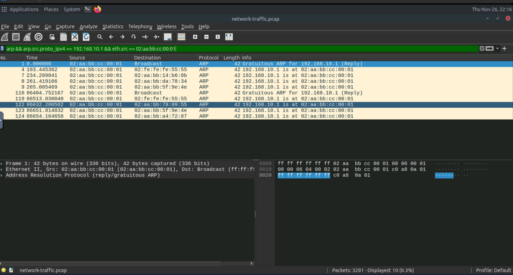
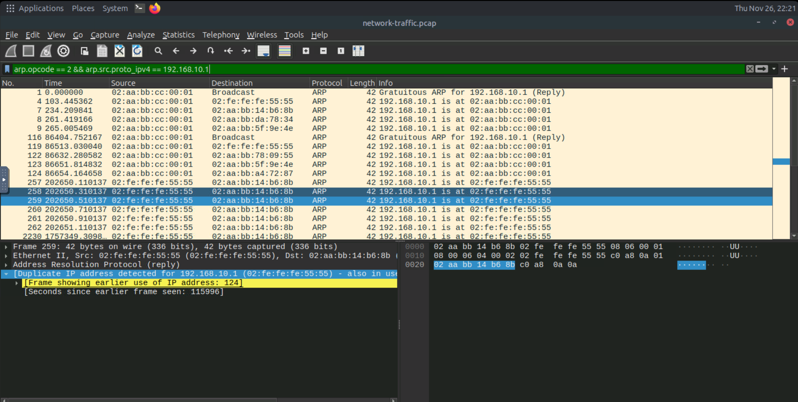
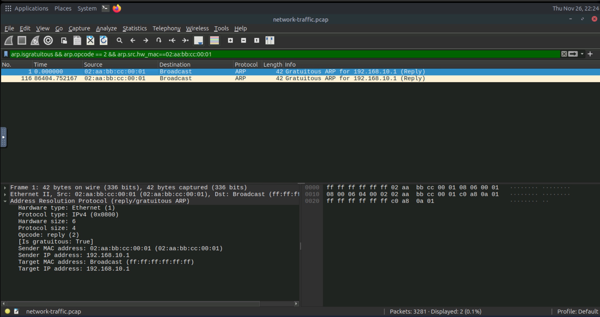
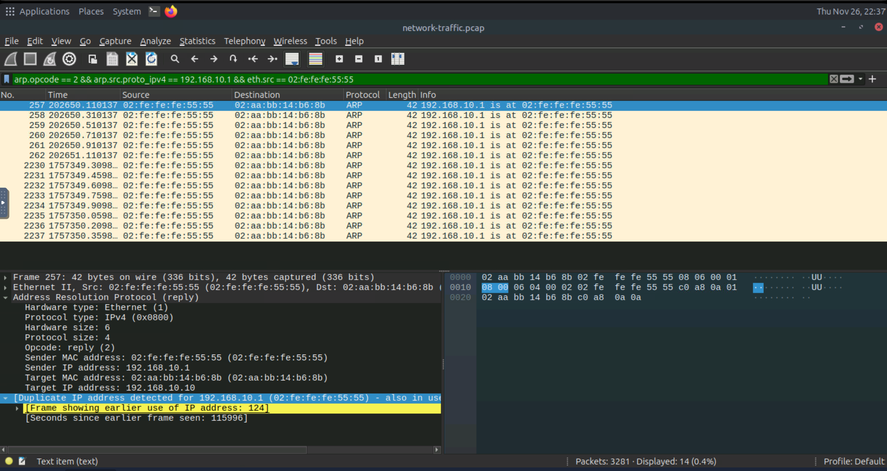
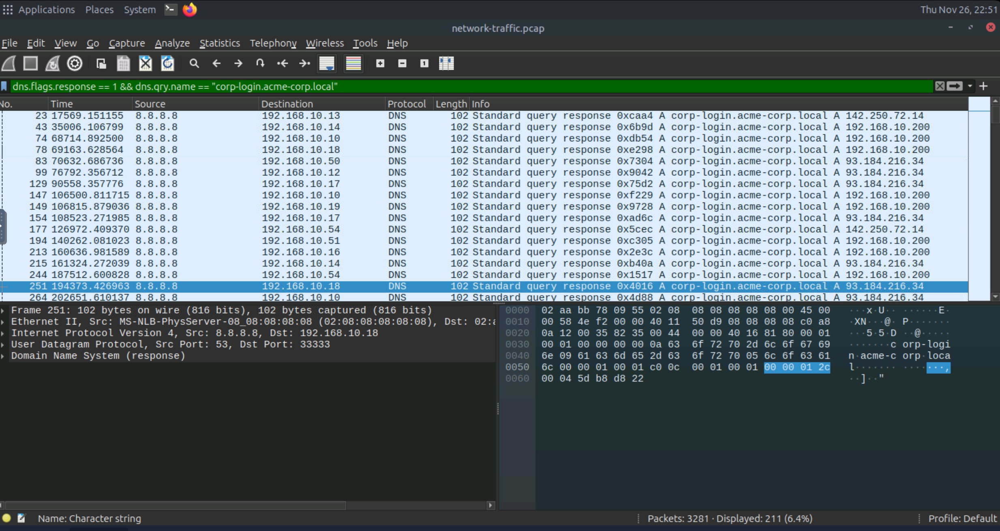
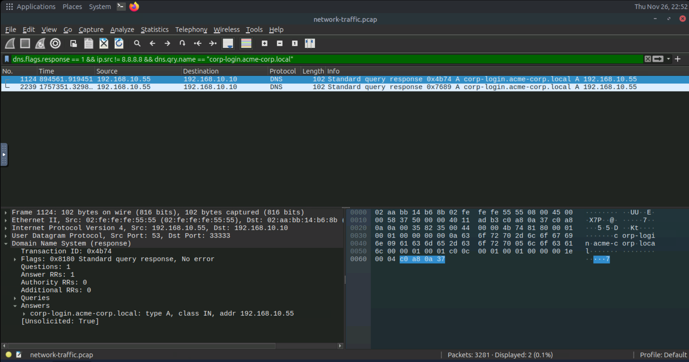
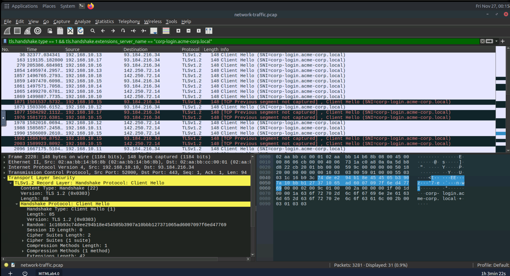
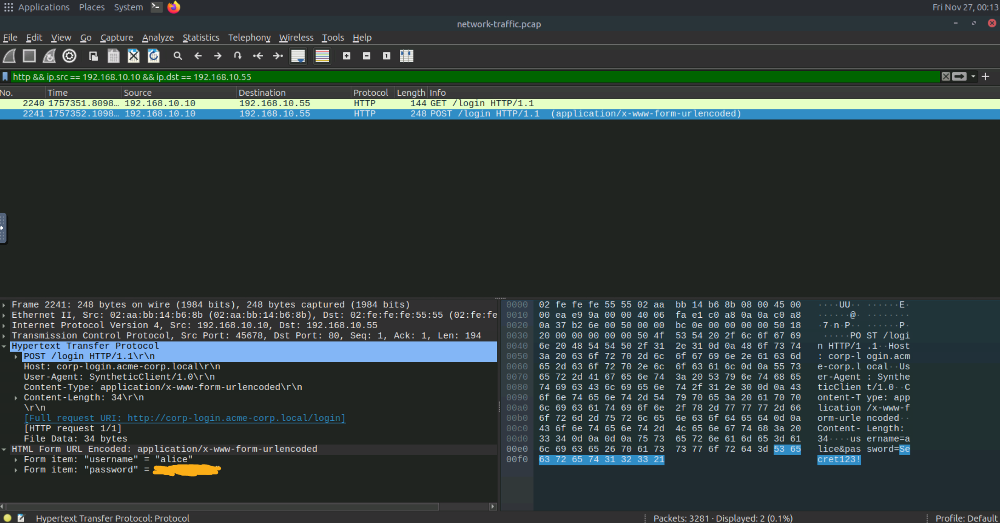

# Man-in-the-Middle (MITM) Attack Detection

## Investigation Overview

| Field | Details |
|---|---|
| Analyst | Erick Hambardzumyan |
| Platform | TryHackMe — SOC Level 1 |
| Investigation | Network Security Monitoring |
| Tool | Wireshark |
| Evidence | `network-traffic.pcap` |
| Packets analyzed | 3,281 (capture total) |
| Severity | High (analyst assessment) |
| Status | Malicious activity identified — simulated lab |

## Executive Summary

This investigation analyzed a packet capture for evidence of man-in-the-middle activity involving ARP spoofing, DNS spoofing, and unencrypted authentication traffic.

The analysis identified repeated fraudulent ARP replies impersonating the default gateway, two suspicious DNS responses redirecting a corporate login domain to an unauthorized host, and an HTTP POST request exposing plaintext credentials. Correlation of IP addresses, MAC addresses, and packet numbers linked these findings to the same suspected attacker and victim.

The evidence is consistent with a MITM attack involving credential interception. Although the capture demonstrates plaintext credential exposure, it does not independently establish the exact SSL stripping mechanism or subsequent account misuse.

## Investigation Objectives

- Establish a baseline for legitimate gateway ARP activity.
- Identify conflicting IP-to-MAC mappings and suspicious ARP replies.
- Investigate unauthorized DNS responses and correlate network indicators.
- Compare TLS connection attempts with unencrypted HTTP authentication traffic.
- Assess incident impact and recommend containment and prevention measures.

## 1. ARP Spoofing Detection

### 1.1 Legitimate Gateway Activity

**Wireshark display filter:**

```wireshark
arp && arp.src.proto_ipv4 == 192.168.10.1 && eth.src == 02:aa:bb:cc:00:01
```



The filter returned 10 ARP packets associated with the legitimate gateway baseline. The gateway IP `192.168.10.1` was consistently advertised by MAC address `02:aa:bb:cc:00:01`.

### 1.2 Conflicting Gateway MAC Addresses

```wireshark
arp.opcode == 2 && arp.src.proto_ipv4 == 192.168.10.1
```



Two distinct MAC addresses claimed ownership of the same gateway IP:

| Gateway IP | MAC address | Assessment |
|---|---|---|
| `192.168.10.1` | `02:aa:bb:cc:00:01` | Legitimate baseline |
| `192.168.10.1` | `02:fe:fe:fe:55:55` | Suspected impersonator |

Wireshark generated a duplicate IP address warning in frame 259 and referenced frame 124 as earlier evidence of the IP address being used by another MAC address. This conflict warranted further investigation for ARP poisoning.

### 1.3 Legitimate Gratuitous ARP Replies

```wireshark
arp.isgratuitous && arp.opcode == 2 && arp.src.hw_mac == 02:aa:bb:cc:00:01
```



Two gratuitous ARP replies were identified in frames 1 and 116. Both originated from the legitimate gateway MAC and were sent to the broadcast address `ff:ff:ff:ff:ff:ff`.

Gratuitous ARP is not inherently malicious. These packets established a baseline against which the targeted fraudulent replies could be compared.

### 1.4 Suspected Attacker ARP Traffic

```wireshark
arp.opcode == 2 && arp.src.proto_ipv4 == 192.168.10.1 && eth.src == 02:fe:fe:fe:55:55
```



The filter returned 14 suspicious ARP replies across frames 257–262 and 2230–2237. All targeted the same victim MAC address. Inspection of frame 257 revealed:

| ARP field | Value |
|---|---|
| Opcode | Reply (2) |
| Sender MAC | `02:fe:fe:fe:55:55` |
| Claimed sender IP | `192.168.10.1` |
| Target MAC | `02:aa:bb:14:b6:8b` |
| Target IP | `192.168.10.10` |

The first burst of replies occurred at approximately 0.2-second intervals. The repeated targeted advertisements are consistent with an attempt to poison the victim's ARP cache and impersonate its gateway.

**Finding:** Strong evidence of targeted ARP spoofing. The victim's actual ARP cache was not available for inspection.

## 2. DNS Spoofing Detection

### 2.1 DNS Response Analysis

```wireshark
dns.flags.response == 1 && dns.qry.name == "corp-login.acme-corp.local"
```



A total of 211 DNS responses were identified for the corporate login domain. Responses from the baseline resolver `8.8.8.8` included the following A-record values:

- `142.250.72.14`
- `192.168.10.200`
- `93.184.216.34`

These values represent observed baseline responses in the simulated capture, not independently verified authoritative DNS records.

### 2.2 Identification of Forged DNS Responses

```wireshark
dns.flags.response == 1 && ip.src != 8.8.8.8 && dns.qry.name == "corp-login.acme-corp.local"
```



Two suspicious DNS responses were identified in frames 1124 and 2239.

| Field | Value |
|---|---|
| Source IP | `192.168.10.55` |
| Source MAC (frame 1124) | `02:fe:fe:fe:55:55` |
| Destination IP | `192.168.10.10` |
| Destination MAC | `02:aa:bb:14:b6:8b` |
| Queried domain | `corp-login.acme-corp.local` |
| Returned A record | `192.168.10.55` |
| Source port | UDP 53 |
| Transaction ID (frame 1124) | `0x4b74` |
| Unsolicited (frame 1124) | True |

The suspicious host returned its own IP address as the resolution for the corporate login domain. Wireshark also marked frame 1124 as unsolicited, meaning no matching request was identified in the capture.

The Ethernet source MAC matched the MAC previously identified in the ARP spoofing investigation, linking the suspicious DNS activity to the same host.

**Finding:** Strong evidence of DNS spoofing targeting the victim and redirecting the corporate login domain to `192.168.10.55`.

## 3. Suspected SSL Stripping and Credential Exposure

### 3.1 TLS Connection Baseline

```wireshark
tls.handshake.type == 1 && tls.handshake.extensions_server_name == "corp-login.acme-corp.local"
```



The filter returned 31 TLS Client Hello packets for the corporate login domain. Frame 2228 showed the victim `192.168.10.10` initiating a TLS connection to `93.184.216.34` over TCP port 443, using the legitimate gateway MAC as its Ethernet destination.

This establishes evidence of an encrypted connection attempt before the later suspicious HTTP requests. A Client Hello alone does not establish successful TLS negotiation.

### 3.2 Unencrypted HTTP Authentication

```wireshark
http && ip.src == 192.168.10.10 && ip.dst == 192.168.10.55
```



Two HTTP requests were identified from the victim to the suspected attacker:

| Frame | Method | Resource |
|---|---|---|
| 2240 | GET | `/login` |
| 2241 | POST | `/login` |

Inspection of frame 2241 revealed:

| Field | Value |
|---|---|
| Source IP | `192.168.10.10` |
| Destination IP | `192.168.10.55` |
| Destination MAC | `02:fe:fe:fe:55:55` |
| Destination port | TCP 80 |
| Host | `corp-login.acme-corp.local` |
| Content type | `application/x-www-form-urlencoded` |
| Username | `alice` (synthetic lab account) |
| Password | Omitted from report |

The HTTP POST contained readable username and password fields. Unlike the earlier TLS connection attempt, this request transmitted authentication data without encryption directly to the suspected attacker host.

**Finding:** Plaintext credential exposure confirmed within the simulated capture. The traffic is consistent with SSL stripping or malicious HTTP redirection; the exact downgrade mechanism is not established by the available evidence.

## 4. Incident Timeline

| Frame(s) | Observed activity |
|---|---|
| 1, 116 | Legitimate gratuitous ARP announcements |
| 124 | Earlier legitimate gateway ARP reply |
| 257–262 | First observed burst of fraudulent ARP replies |
| 1124 | Suspicious unsolicited DNS response |
| 2228 | Victim TLS Client Hello via legitimate gateway |
| 2230–2237 | Second burst of fraudulent ARP replies |
| 2239 | Suspicious DNS response returning attacker IP |
| 2240 | Victim HTTP GET request to attacker host |
| 2241 | Victim HTTP POST containing plaintext credentials |

The final cluster of frames supports correlation between gateway impersonation, DNS redirection, and credential exposure. The capture does not establish that every earlier event was part of one uninterrupted attack session.

## 5. Indicators of Compromise

| Indicator | Type | Role |
|---|---|---|
| `192.168.10.55` | IPv4 | Suspected attacker host |
| `02:fe:fe:fe:55:55` | MAC | Suspected attacker interface |
| `192.168.10.10` | IPv4 | Targeted victim |
| `02:aa:bb:14:b6:8b` | MAC | Victim interface |
| `192.168.10.1` | IPv4 | Impersonated gateway |
| `corp-login.acme-corp.local` | Domain | Targeted login service |

The victim, gateway, and targeted domain are contextual indicators, not inherently malicious entities. All indicators belong to a simulated training environment.

## 6. MITRE ATT&CK Mapping

| Technique | ID | Relevance |
|---|---|---|
| Adversary-in-the-Middle | T1557 | Suspected traffic interception and manipulation |
| ARP Cache Poisoning | T1557.002 | Fraudulent gateway ARP advertisements |
| Network Sniffing | T1040 | Potential collection of exposed credentials; attacker-side capture not independently verified |

## 7. Impact and Severity Assessment

**Severity: High**

- Confidentiality: Authentication credentials were transmitted in plaintext to a suspicious host.
- Integrity: ARP and DNS mappings were subject to suspected manipulation.
- Potential business impact: Unauthorized account access, session interception, and further compromise if the exposed credentials were reused.

Actual account takeover, lateral movement, and service disruption were not established by the supplied evidence.

## 8. Recommended Response and Mitigation

### Immediate containment

- Preserve the PCAP and relevant endpoint, DNS, and switch logs.
- Isolate the suspected attacker host after validating its identity.
- Reset exposed credentials and revoke associated active sessions.
- Validate and restore legitimate ARP and DNS mappings.
- Investigate additional hosts for similar traffic patterns.

### Long-term prevention

- Enable Dynamic ARP Inspection with appropriate DHCP snooping or static bindings.
- Restrict DNS traffic to approved resolvers and monitor unauthorized DNS responses.
- Enforce HTTPS and HTTP Strict Transport Security (HSTS) for authentication services.
- Deploy network detection rules for duplicate gateway IP claims, repeated ARP replies, and plaintext authentication traffic.
- Implement network segmentation and multifactor authentication.

## 9. Conclusion

This investigation demonstrated how packet-level analysis can correlate multiple suspicious network behaviors into a coherent incident assessment. The same suspected attacker MAC appeared in fraudulent ARP replies and an unauthorized DNS response, while subsequent HTTP traffic from the victim was directed to the suspected attacker's IP and MAC addresses.

The evidence supports targeted ARP spoofing, DNS spoofing, and confirmed plaintext credential exposure, with suspected SSL stripping or HTTP redirection. Further endpoint and network telemetry would be required to verify the exact downgrade mechanism and determine whether the exposed credentials were subsequently used.

## Skills Demonstrated

- Network traffic analysis using Wireshark
- ARP, DNS, HTTP, and TLS protocol analysis
- PCAP filtering and packet inspection
- Indicator identification and cross-protocol correlation
- Incident timeline reconstruction
- Severity assessment and incident response recommendations
- MITRE ATT&CK technique mapping

---

**Disclaimer:** This investigation was conducted in an authorized TryHackMe training environment using simulated network traffic. The report is intended for educational and defensive cybersecurity portfolio purposes.
