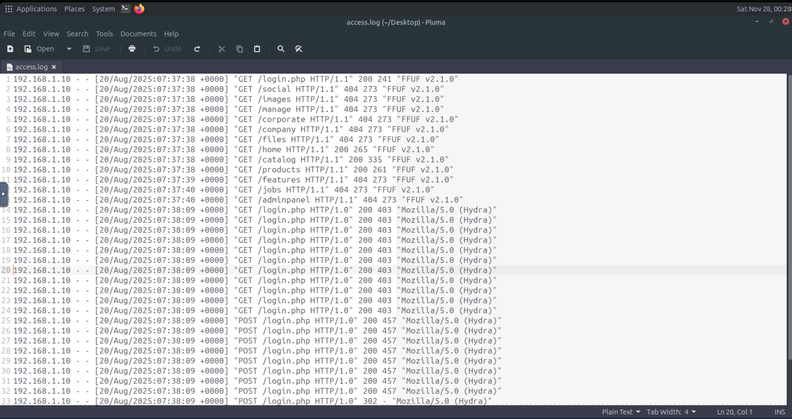
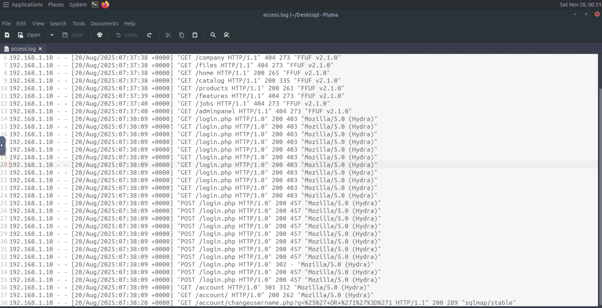
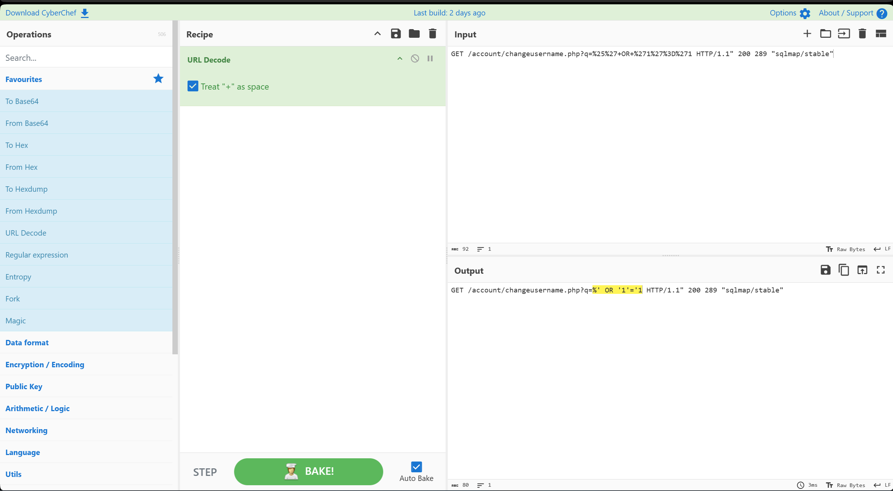
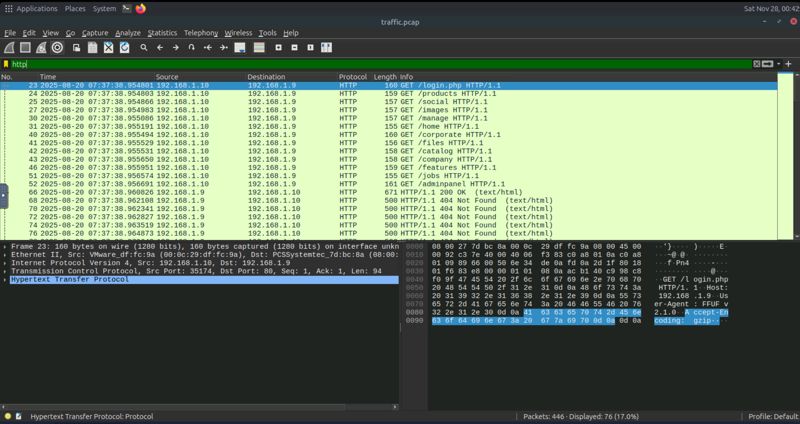
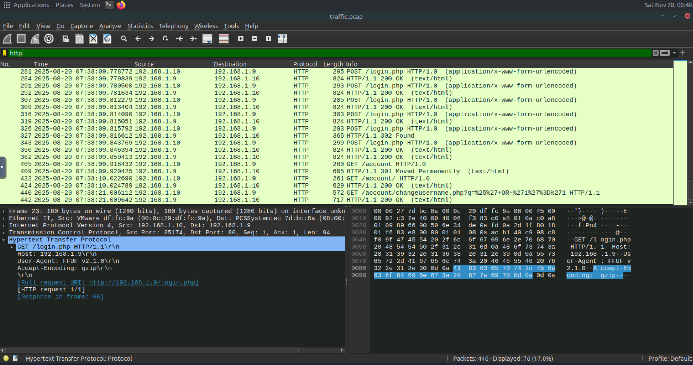
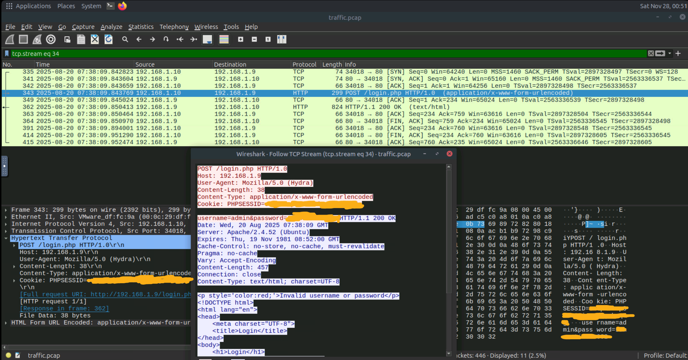
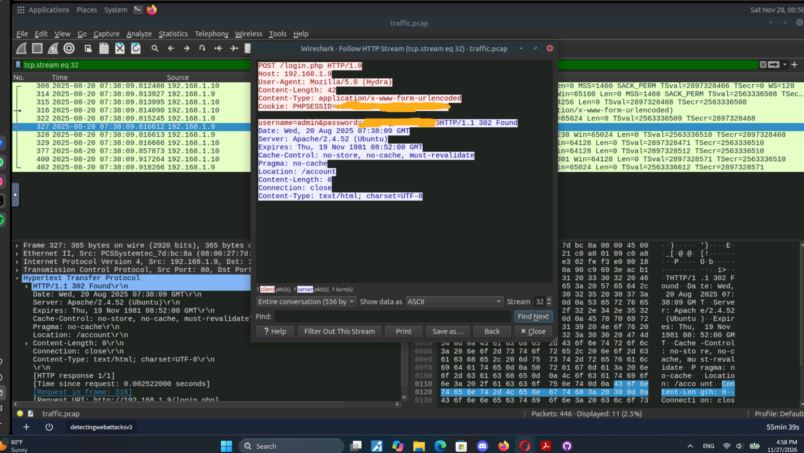
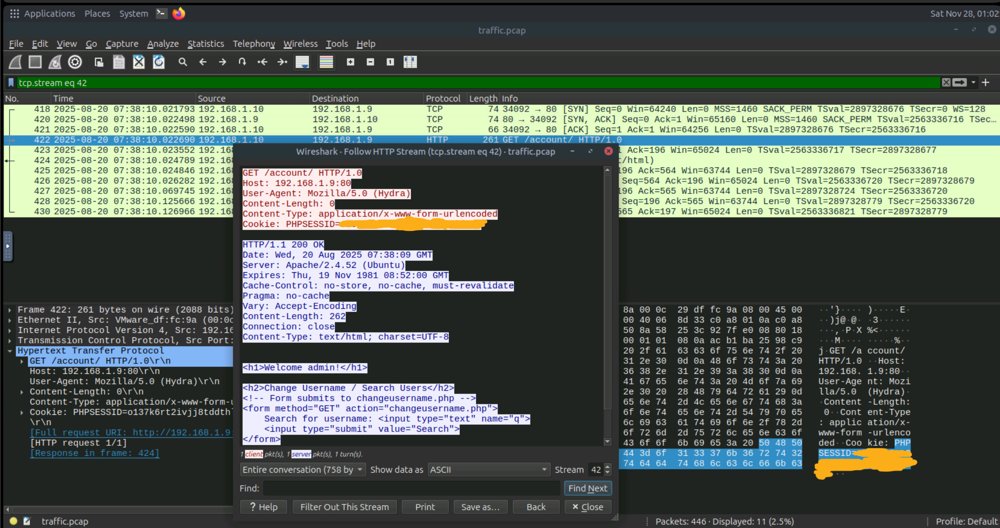
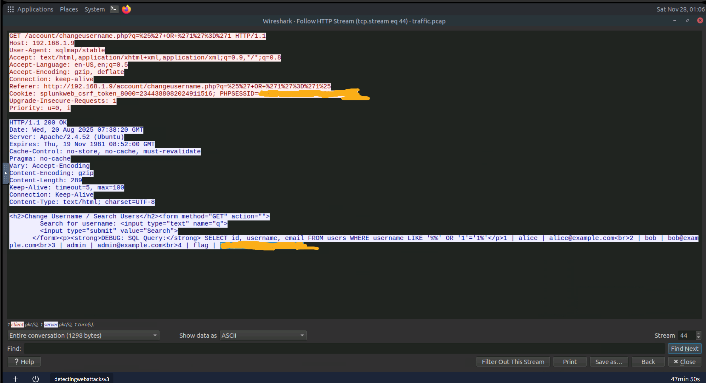

# Detecting Web Attacks – Web Security Investigation

**Analyst:** Erick Hambardzumyan  
**Platform:** TryHackMe – SOC Level 1  
**Project Type:** Web Security Monitoring and Incident Investigation  
**Incident Date:** August 20, 2025 (UTC)  
**Verdict:** Confirmed malicious activity (simulated lab)  
**Severity:** High (analyst assessment)

## Executive Summary

I investigated suspicious activity against the TryBankMe web application by correlating web server access logs with network packet captures. The evidence revealed automated web content discovery, password brute forcing, successful administrator authentication, authenticated account access, and SQL injection resulting in disclosure of four database records.

The investigation demonstrates the importance of validating attack outcomes using HTTP response bodies and session correlation rather than relying solely on HTTP status codes or suspicious User-Agent strings.

## Investigation Objectives

- Identify automated web enumeration and authentication attacks.
- Decode suspicious URL-encoded input and identify SQL injection indicators.
- Correlate web access logs with packet-level evidence.
- Distinguish failed authentication from successful account access.
- Assess confirmed impact and recommend defensive controls.

## Tools and Evidence Sources

| Tool / artifact | Purpose |
|---|---|
| `access.log` | Web request, timestamp, status code and User-Agent analysis |
| Pluma | Review of web server logs |
| Wireshark | HTTP packet analysis and TCP/HTTP stream reconstruction |
| `traffic.pcap` | Network evidence |
| CyberChef | URL decoding |

## 1. Log-Based Detection

### 1.1 Directory Fuzzing

The first 13 access log entries show rapid GET requests from `192.168.1.10` between 07:37:38 and 07:37:40 UTC. The requests target different application paths and contain the User-Agent `FFUF v2.1.0`, consistent with automated content discovery.

| Metric | Result |
|---|---|
| Source IP | `192.168.1.10` |
| Requests | 13 |
| HTTP 200 | 4 |
| HTTP 404 | 9 |
| Paths returning HTTP 200 | `/login.php`, `/home`, `/catalog`, `/products` |

The rapid request rate, varied paths, and mix of successful and unsuccessful responses support the enumeration finding. A User-Agent can be spoofed and is not conclusive by itself.

### 1.2 Brute-Force Detection

At 07:38:09 UTC, the same source IP generated repeated GET and POST requests to `/login.php` using `Mozilla/5.0 (Hydra)`.

The visible log contains 11 POST requests: ten returned HTTP 200 with a response size of 457 bytes, and one returned HTTP 302. Subsequent requests to `/account` and `/account/` returned HTTP 301 and HTTP 200 respectively.

The redirect suggested successful authentication, but packet-level analysis was necessary to verify it.

### 1.3 SQL Injection Detection

At 07:38:20 UTC, the access log recorded a suspicious GET request to `/account/changeusername.php` targeting the `q` parameter. The request used the User-Agent `sqlmap/stable` and returned HTTP 200.

### 1.4 Payload Decoding

I used CyberChef's URL Decode operation with the option to treat plus signs as spaces. The decoded input contained an SQL Boolean expression consistent with an attempt to manipulate the application's search query.

The log and decoded input establish an injection attempt; the HTTP response body is needed to establish its impact.

## 2. Network-Based Detection

### 2.1 HTTP Traffic Overview

I applied the Wireshark display filter `http` to isolate application-layer traffic.

| Metric | Result |
|---|---|
| Total captured packets | 446 |
| Packets matching HTTP filter | 76 (17.0%) |
| Suspicious source | `192.168.1.10` |
| Target server | `192.168.1.9` |
| Destination service | TCP port 80 |

The packet capture corroborates the directory enumeration observed in the access log.

### 2.2 Brute-Force Packet Analysis

Repeated HTTP POST requests and corresponding server responses were visible in the capture, including a 302 response in frame 327.

Because multiple connections were active concurrently, I used Wireshark's linked request/response frame references and Follow Stream functionality to correlate transactions rather than assuming adjacent packets belonged together.

### 2.3 Failed Authentication

TCP stream 34 contains a POST request targeting the `admin` account in frame 343 and its response in frame 362. The server returned HTTP 200, but the response body explicitly stated `Invalid username or password`.

This confirms a failed login despite the HTTP 200 status. The submitted password and session identifier are omitted from this report.

### 2.4 Successful Authentication

TCP stream 32 contains the login request in frame 316 and its response in frame 327. The response returned `302 Found` with `Location: /account` and a zero-byte response body.

| Indicator | Failed login | Successful login |
|---|---|---|
| TCP stream | 34 | 32 |
| Request frame | 343 | 316 |
| Response frame | 362 | 327 |
| HTTP status | 200 | 302 |
| Response content length | 457 bytes | 0 bytes |
| Application behavior | Invalid credentials | Redirect to `/account` |

The redirect is strong evidence of successful authentication; subsequent session activity confirms the outcome.

### 2.5 Authenticated Account Access

TCP stream 42 contains `GET /account/` in frame 422 and HTTP 200 in frame 424. The response body displays `Welcome admin!` and a user search form. The PHP session identifier matches the one observed in TCP stream 32.

This confirms that the successful login session accessed the administrator account page.

### 2.6 SQL Injection and Data Exposure

TCP stream 44 contains the suspicious request in frame 440 and its response in frame 442. The reconstructed HTTP response exposes a debug SQL query referencing the `users` table and returns four records containing IDs, usernames and email-field values.

| Field | Finding |
|---|---|
| Endpoint | `/account/changeusername.php` |
| Parameter | `q` |
| HTTP response | 200 OK |
| Server | Apache/2.4.52 (Ubuntu) |
| Response encoding | gzip |
| Records disclosed | 4 |
| Verdict | Successful SQL injection and data disclosure |

The response confirms disclosure of database records, but does not establish compromise of the entire database. The SQL injection request uses a different PHP session identifier from the Hydra login session; the shared source IP and chronology support correlation, but do not prove session continuity or a single operator.

## 3. Incident Timeline

All times below refer to August 20, 2025. Packet timestamps are consistent with the log chronology, with minor differences between capture and server timestamps.

| Time (UTC) | Activity | Outcome |
|---|---|---|
| 07:37:38–07:37:40 | FFUF content discovery | Four paths returned HTTP 200 |
| 07:38:09 | Hydra authentication attempts | Failed attempts and successful login observed |
| 07:38:09–07:38:10 | Account page access | Administrator access confirmed |
| 07:38:20–07:38:21 | SQL injection | Four database records disclosed |

## 4. Indicators and Detection Opportunities

| Indicator | Context |
|---|---|
| `192.168.1.10` | Source of suspicious activity in the lab |
| `192.168.1.9` | Affected web server |
| `FFUF v2.1.0` | Enumeration-associated User-Agent |
| `Mozilla/5.0 (Hydra)` | Brute-force-associated User-Agent |
| `sqlmap/stable` | SQL injection-associated User-Agent |
| `/login.php` | Authentication endpoint targeted |
| `/account/changeusername.php` | SQL injection endpoint targeted |

These private IP addresses are lab-specific observables, not globally actionable threat intelligence. User-Agent strings are supporting indicators rather than definitive attribution.

Recommended detection logic: monitor bursts of requests to distinct paths, repeated authentication failures followed by successful login, suspicious SQL syntax in normalized query parameters, and unusual responses containing database records. Correlate events by source, account, session and time window where available.

## 5. MITRE ATT&CK Mapping

| Technique | Evidence / qualification |
|---|---|
| T1110.001 – Password Guessing | Repeated password attempts against the administrator account |
| T1078 – Valid Accounts | Successful authentication and subsequent account access |
| T1595 – Active Scanning | Content discovery consistent with active scanning; external reconnaissance context is not established |
| T1190 – Exploit Public-Facing Application | SQL injection is consistent with application exploitation; public-facing exposure is not established in this private lab |

The final two mappings are contextual candidates rather than confirmed tactic assignments. No persistence, lateral movement or database-wide compromise was established.

## 6. Impact and Severity

**Severity: High (analyst assessment).** The evidence confirms administrator account access and disclosure of database records. Confidentiality was affected. No unauthorized data modification, service disruption or broader infrastructure compromise was demonstrated.

Plaintext HTTP also exposed authentication form data and session identifiers to packet inspection. The actual exposure scope beyond the supplied capture remains unknown.

## 7. Recommended Response and Mitigation

| Priority | Recommended action |
|---|---|
| Immediate | Preserve logs and packet evidence; investigate the source host and affected account |
| Immediate | Reset compromised credentials and invalidate active sessions |
| Immediate | Restrict access to the vulnerable endpoint pending remediation |
| High | Replace unsafe SQL query construction with parameterized queries and enforce least-privilege database access |
| High | Implement MFA, authentication throttling and appropriate account protection |
| High | Enforce HTTPS and secure session cookie settings |
| High | Disable SQL debug output in production |
| Ongoing | Configure and tune WAF rules, monitor authentication and application anomalies, and validate fixes through authorized testing |

These are recommendations, not controls implemented or tested during this investigation. No WAF configuration or validation evidence was supplied.

## 8. SOC Analyst Takeaways

- HTTP status codes alone do not establish authentication or exploitation outcomes.
- Concurrent connections require explicit request/response correlation.
- Session identifiers can link authenticated activity across separate TCP connections.
- URL decoding helps identify suspicious input hidden by encoding.
- Server logs and reconstructed HTTP responses provide complementary evidence.
- Confirmed data exposure must be distinguished from unverified broader compromise.

## 9. Skills Demonstrated

Web server log analysis, Wireshark PCAP analysis, HTTP stream reconstruction, URL decoding, brute-force detection, SQL injection detection, session correlation, incident timeline reconstruction, impact assessment, MITRE ATT&CK mapping and defensive recommendations.

## Conclusion

This investigation reconstructed a sequence of web attacks using access logs and packet-level evidence. It confirmed successful administrator authentication and account access, as well as SQL injection resulting in disclosure of four records. The findings demonstrate evidence-based SOC investigation and the importance of validating attack impact before escalation.

## Lab Reference and Disclaimer

[TryHackMe – Detecting Web Attacks](https://tryhackme.com/room/detectingwebattacks)

All activity was investigated within an authorized training environment. Passwords, session identifiers, CSRF tokens and challenge flags are intentionally omitted from the report text. Screenshot copies must be redacted before public publication, including any sensitive values visible in packet details, ASCII and hexadecimal panes.
